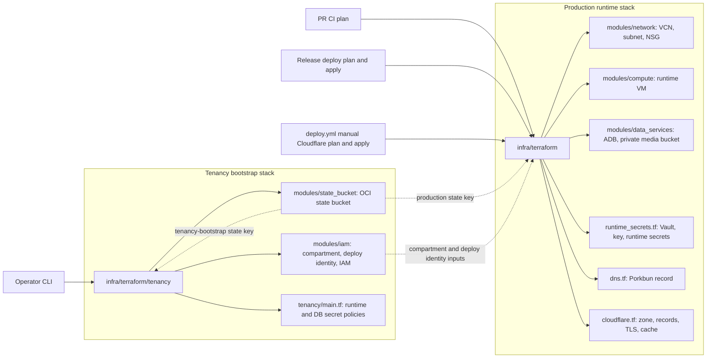

# Terraform and Ansible operational review findings

Status: inventory and contract review in progress for Phase 8 Plan 08-08 Task 5.
This register records source evidence before cleanup changes are selected. A
source inventory is not a final disposition or proof that production state
matches configuration.

## Operating boundary

The tenancy root owns the project compartment, deploy identity and policies,
and the OCI state bucket. The production root owns network, runtime compute,
Vault secrets, the staged Oracle database and private media bucket, the
Porkbun record during migration, and the Cloudflare zone, records, strict TLS,
and cache rules. CI plans against production state. Release deployment saves a
plan and applies that exact file only after rejecting Cloudflare or Porkbun DNS
changes. Manual Cloudflare operations in that workflow accept a reviewed
change fingerprint and apply their own saved plan. Ansible handles deploy freeze, runtime
replacement, health and unfreeze, rollback, security maintenance, and cleanup.

The shared invariant for this review is: an ordinary release must preserve the
existing stateful data and DNS ownership, keep publication frozen while the
controller is replaced, and fail visibly before an unreviewed destructive
change. Production state addresses and a sanitized current-input saved plan
are required to prove that invariant; source defaults alone cannot prove it.

### Terraform stack and module map

The two roots have separate state keys in the same OCI Object Storage bucket:
`envs/prod/tenancy-bootstrap.tfstate` and `envs/prod/terraform.tfstate`.
PR CI authenticates and plans only the production root; it initializes and
validates the tenancy root without a live plan. The release and Cloudflare
workflows also target the production root. Tenancy changes require a separate
operator plan against the tenancy bootstrap state before apply.

## Production inputs observed

On 2026-11-15, read-only GitHub variable queries returned
`CLOUDFLARE_MODE=proxied`, `OCI_CREATE_AUTONOMOUS_DATABASE=true`,
`OCI_CREATE_MEDIA_BUCKET=true`, and
`OCI_AUTONOMOUS_DATABASE_IS_MTLS_CONNECTION_REQUIRED=true`.
At that observation, the first three values differed from Terraform's
`off`/`false` defaults. The query alone did not establish the corresponding
Terraform state or plan result. Secret values were not read. PR #354 later
merged and the mTLS variable was removed after its no-change production check.

There are two different cases in this review. **Missing configuration before
PR #358** meant a GitHub Actions variable disappeared while the workflows
supplied their `false` fallback; the Terraform `count` expressions then
evaluated to zero. PR #358 fixed that path. **Deliberately removing a switch
from the code** is a
refactor: its workflow input, root and module arguments, conditional resources
and lookups, outputs, tests, and documentation must change together. Keeping a
resource counted at one can preserve its `[0]` state address; removing `count`
also changes that address and needs a reviewed Terraform `moved` transition.
No finding below treats deletion of a variable declaration alone as a complete
or valid refactor.

## Preliminary findings

| ID | Severity | Finding and evidence | Disposition | Required proof or change |
|---|---|---|---|---|
| IAC-001 | Warning | Before PR #358, CI, release deploy, and Cloudflare workflows substituted `false` when either optional resource-creation GitHub variable was absent. That could reduce the ADB or private media bucket `count` to zero; the database input also gates Vault lookups and rotation (`infra/terraform/main.tf`, `runtime_secrets.tf`, `modules/data_services/main.tf`). | Fixed by [PR #358](https://github.com/jetsaredim/autographs/pull/358) and verified after variable removal | The authenticated PR plan and post-removal read-only production plan both reported no changes. Explicit `false` remains available for initial bootstrap. |
| IAC-002 | Warning | CI planned against production state without rejecting destructive actions; routine deployment checked only DNS changes before applying the saved plan. | Guard implemented; production proof pending | CI and routine deploy now reject managed-resource delete, replacement, and state-forget actions from the saved plan. An explicit retry with `recreate_runtime_instance=true` permits replacement of only the runtime VM. Confirm the authenticated production plan and PR checks before final disposition. |
| IAC-003 | Info | Before this cleanup, `create_network` and `create_runtime_instance` defaulted to `true`; explicit `false` would remove managed network/VM resources. No production workflow supplied either input. Runtime recreation uses a separate retry-only taint. | Resolved by [PR #361](https://github.com/jetsaredim/autographs/pull/361), pending all CI gates | Seven counted resources have `moved` mappings; ingress rule `for_each` keys remain stable. The authenticated production plan reported `0 to add, 0 to change, 0 to destroy`; retry taint accepts both state addresses. |
| IAC-004 | Info | `cloudflare_mode` is `proxied` in production. A missing variable becomes `off` in ordinary deploy/CI, but the deploy saved-plan guard rejects changed Cloudflare resources. The operator workflow requires explicit `dns_only` or `proxied` and checks plan scope and fingerprint. | Retain pending plan proof | Confirm a no-change plan and a missing-mode rejection test; preserve proxy persistence and DNS mutation guard. |
| IAC-005 | Info | Full deploy requires `autographs_deploy_publish_frozen` and `autographs_deploy_explicit_cutover`; unfreeze uses `autographs_deploy_allow_unfreeze`, and restart handlers are suppressed during explicit cutover. | Investigate as one contract | Trace preflight, full deploy, unfreeze, failure rescue, rollback, and fixtures before consolidating any flag. |
| IAC-006 | Info | `security_patching_reboot_validate_dnf_noop` defaults true and is set false in reboot-state fixtures; production validation tasks use it to gate DNF no-op checks. | Investigate test seam | Verify both fixture paths and the production fail-closed behavior before changing the switch. |
| IAC-007 | Info | `create_runtime_instance` described a retired Caddy-to-Next.js runtime. | Resolved with IAC-003 switch removal | The obsolete variable description is removed; the VM remains the Caddy/Rust runtime. |

IAC-001 and IAC-002 share the stateful-resource preservation invariant. The
source and production-plan resolution for IAC-001 is recorded below. IAC-002
now has a shared plan policy in `scripts/validate_terraform_plan.py`, called
by CI and the ordinary release workflow before apply. The policy rejects
deletes, replacements, state forgets, and unknown managed-resource actions;
the explicit runtime recreation retry admits only a replacement of the
runtime VM. The existing DNS guard remains separate. Final IAC-002 closure
requires an authenticated PR plan, passing CI, and review of the remaining
operating-contract inventory.

PR #354 adds `prevent_destroy` to the ADB, private media bucket, and tenancy
state bucket. This blocks a plan that destroys or replaces one of these
resources while its resource block remains configured, including a counted ADB
or media bucket whose `count` becomes zero. It does not protect a resource if
its entire configuration is removed. The missing destructive-plan policy
remains IAC-002 work; this guard is a partial mitigation for that finding. The runtime VM
keeps its intentional taint-and-replace recovery path.

### IAC-001 resolution and production proof

The owner proposed making `true` the code default for the two production
resource-creation switches and then removing their GitHub Actions variables.
That is a coherent simplification if it changes **both** the Terraform root
defaults and the `vars.* || 'false'` fallbacks in CI, release deploy, and the
Cloudflare operator workflow. Changing only Terraform's defaults would have no
effect in those workflows because they always set `TF_VAR_*`. An explicit
`false` remains available for the documented initial bootstrap before Vault
secrets and the Object Storage namespace are ready.

The sequence was completed: PR #358 merged as `797e387` after all required
checks passed. Its [authenticated Terraform CI job](https://github.com/jetsaredim/autographs/actions/runs/44111310814/job/134137340094)
reported `No changes` with both GitHub variables still `true`. The two
repository variables were then deleted. The read-only
[main operator plan run 44112638567](https://github.com/jetsaredim/autographs/actions/runs/44112638567)
reported `No changes`, `Cloudflare change count: 0`, and `Plan only: no
Terraform apply was run`. Its checked-out commit was `797e387`; the workflow
required the existing Cloudflare state addresses before planning. This proves
the missing-variable workflow fallback retains the managed resources under
the current production inputs. The counted `[0]` resource addresses and
explicit `false` bootstrap overrides are unchanged.

A later removal of the Terraform switches themselves must update
their conditional consumers and move each affected counted instance, such as
`module.data_services.oci_database_autonomous_database.catalog[0]` and
`module.data_services.oci_objectstorage_bucket.media[0]`, to its new address
with reviewed `moved` blocks or an equivalent state migration. That later PR
must show a no-destroy, no-recreate production plan before apply. IAC-002's
broader destructive-plan policy remains a separate review decision.

This closes IAC-001. IAC-002 remains open.

## Switch census and direct boundaries

This census covers root Terraform Boolean/mode inputs, production Ansible
Boolean/mode inputs found in role defaults or workflow calls, and maintenance
workflow dispatch modes. Module inputs that simply forward a root value are
traced with the root input. Fixture probe overrides remain in the role-task
inventory until their supported test paths are classified. Effects described
for `false` or missing inputs refer to the code as it exists today, not to a
proposed refactor that removes the input and its conditional consumers.

| Switch or mode | Producer and current/default value | Direct consumer and unsafe transition | Review state |
|---|---|---|---|
| `create_network` | Removed from root and module in PR #361; no workflow override existed | VCN, subnet, gateway, route table, NSG, and egress rule move from `[0]` to uncounted addresses; ingress rule keys stay unchanged. | IAC-003; authenticated plan has no provider changes. |
| `create_runtime_instance` | Removed from root and module in PR #361; no workflow override existed | VM moves from `[0]` to uncounted address; image lookup still runs when no explicit image OCID is supplied. Retry-only `recreate_runtime_instance` remains. | IAC-003; authenticated plan has no provider changes. |
| `create_autonomous_database` | Removed from root, module, and workflows in the ADB bootstrap cleanup | A moved block maps the counted ADB state address to the uncounted resource; the reviewer-gated `bootstrap_secrets` operation owns fresh Vault setup. | Require authenticated no-destroy production plan before merge. |
| `create_media_bucket` | Removed from the root, module, examples, and all three workflow environments by [PR #360](https://github.com/jetsaredim/autographs/pull/360) | The private bucket remains managed from the first runtime-root apply; its namespace must be supplied. A `moved` block maps the existing `[0]` state address to the uncounted address. | Authenticated PR plan: `0 to add, 0 to change, 0 to destroy`; no apply. |
| `assign_public_ip` | Fixed `true` in the compute resource; root and module inputs removed | VM VNIC retains its public IP. | PR production plan to verify. |
| ADB `is_free_tier` | Hardcoded `true` in the data services resource; former root/module input removed | Fixes the database to Oracle Always Free. The existing counted resource address is unchanged. | PR CI production plan returned no changes. |
| ADB `is_mtls_connection_required` | Hardcoded `true` in the data services resource; former GitHub/workflow and Terraform inputs removed in PR #354 | Requires wallet-based connections. Existing counted resource address is unchanged. | Local validation and PR CI production no-change plan passed. Remove the now-unused GitHub variable after merge. |
| Media bucket `versioning` | Hardcoded `Enabled` in the data services resource in PR #354 | Preserves private Object Storage recovery posture. Existing counted resource address is unchanged. | Local validation and PR CI production no-change plan passed. |
| Root and tenancy OCI `auth` | Terraform default `APIKey`; accepts `APIKey`/`SecurityToken` | Selects OCI provider authentication for production or bootstrap state. | Confirm each root's operator entry point and credential source. |
| State bucket `storage_tier` | Hardcoded `Standard` in the state bucket module in PR #354 | Keeps Terraform state promptly retrievable. Existing uncounted resource address is unchanged. | Local validation and authenticated tenancy-root no-change plan passed on 2026-11-15; no apply. |
| `cloudflare_mode` | GitHub variable `proxied`; root default and deploy/CI fallback `off` | Counts zone, records, TLS, rules; `dns_only` preserves zone but changes proxy flag; ordinary deploy DNS guard rejects changes. | IAC-004; preserve controlled transitions. |
| `runtime_secret_values_ready` | Derived from three Vault CURRENT-version checks during normal plans | Blocks ADB creation/update until the generated DB password and manually populated secrets are ready. Bootstrap skips the reads only during its saved targeted plan. | Preserve fail-closed precondition; verify missing and bootstrap versions. |
| `autographs_deploy_publish_frozen` | Role default and deploy input `true`; unfreeze sets `false` | Full-deploy assertion and exact Caddy publish gate. | IAC-005; trace as one cutover contract. |
| `autographs_deploy_explicit_cutover` | Role default `true` | Full-deploy assertion and restart-handler suppression. | IAC-005; trace role notifications and fixtures. |
| `autographs_deploy_allow_unfreeze` | Absent/false by default; unfreeze sets `true` | Allows removal of publish gate when frozen flag becomes false. | IAC-005; verify failure rescue and no bypass. |
| `autographs_publish_unfreeze_verify_only` | Unfreeze default `false`; deploy invokes true then false | First invocation checks origin readiness without removing gate; second removes it after health. | Trace both paths and failed second step. |
| `autographs_system_cleanup_dry_run` | Role default string `"false"`; image-cleanup workflow input | Controls Podman cleanup mutation. | Verify preview and execute paths. |
| `security_patching_reboot_validate_dnf_noop` | Role default `true`; fixture overrides true/false | Gates DNF no-op proof before reboot cleanup. | IAC-006; verify production and test seam. |
| Security update/reboot approval labels | GitHub issue labels and approved workflow events | Separate update and reboot paths validate current scanner state before mutation. | Trace issue update, approval removal, cleanup, and retry. |
| `recreate_runtime_instance` | Deploy workflow dispatch Boolean, default false | Retry-only taint of tracked compute address before saved plan. | Verify replacement gate and rollback path. |
| Release `operation` | Manual deploy workflow choice `retry`/`rollback`; push to `main` follows the release path | Selects retry or controller rollback on manual runs while normal release processing follows the push event. | Trace every branch through status reporting and failure cleanup. |
| Cloudflare `operation` | Operator workflow choice `plan`/`apply` | Apply requires a matching nonempty plan fingerprint. | Current plan-only run passed; retain. |
| Image cleanup `dry_run` / `remote_operation` | Scheduled or manual `image-cleanup.yml`; manual options `inventory`/`delete` | Scheduled local Podman cleanup gets `dry_run=false` and may prune; scheduled GHCR remains dry-run. Manual GHCR deletion requires explicit `delete`; the manual local dry-run input is independent. | Trace both local and remote actions and protected tags. |

### Fixed-policy input validation

The Always Free change removes one root/module pass-through and fixes the
existing resource argument to `true`. It does not change the `count` expression
or resource address. The production tfvars example no longer advertises a paid
tier override. Each additional input below was changed and validated locally
one at a time. None of the changes alters a resource `count`, `for_each`, or
Terraform address. The PR CI authenticated production plan on
[run 43746652748](https://github.com/jetsaredim/autographs/actions/runs/43746652748)
returned no changes. Local validation used the pinned providers with an
isolated `TF_DATA_DIR` and `-backend=false`; that local validation did not read
production or tenancy state.

| Former input | Fixed resource value and local check | Live proof / follow-up |
|---|---|---|
| `autonomous_database_is_mtls_connection_required` | ADB `is_mtls_connection_required = true`; production-root `terraform validate` passed after removing the three workflow inputs and updating wallet docs. | PR CI production plan returned no changes. Remove unused GitHub variable only after merge and recheck. |
| `autonomous_database_db_workload` | ADB `db_workload = "OLTP"`; production-root `terraform validate` passed. | PR CI production plan returned no changes. |
| `autonomous_database_license_model` | ADB `license_model = "LICENSE_INCLUDED"`; production-root `terraform validate` passed. | PR CI production plan returned no changes for this billing-related argument. |
| `autonomous_database_data_storage_size_in_tbs` | ADB `data_storage_size_in_tbs = 1`; production-root `terraform validate` passed. OCI ignores this sizing request on Always Free databases; it is not the effective storage size. | PR CI production plan returned no changes. |
| `media_bucket_versioning` | Private bucket `versioning = "Enabled"`; production-root `terraform validate` passed. | PR CI production plan returned no changes. |
| `state_bucket_storage_tier` | State bucket `storage_tier = "Standard"`; tenancy-root `terraform validate` passed. | Authenticated plan against `envs/prod/tenancy-bootstrap.tfstate` returned no changes on 2026-11-15; no apply. |

The remaining database resource-presence switch determines a supported
bootstrap path; the network and runtime switches had no production false-state
use and are being removed with state-preserving moves. The media bucket had no
secret-readiness dependency, so its switch was removed with the
state-preserving move and namespace precondition below.

### Media bucket conditional retirement

**Invariant:** The existing private bucket keeps its production identity and
Terraform ownership, with no create, update, replacement, or destruction. A
fresh runtime-root apply requires the real Object Storage namespace and may
create the bucket before the manual Vault secrets are ready.

The direct producer was root `create_media_bucket`, forwarded into
`module.data_services` and set as `TF_VAR_create_media_bucket` by CI, release
deploy, and the manual Cloudflare job. Its consumers were the bucket `count`,
the namespace precondition, and documentation/example bootstrap overrides.
The bucket name and namespace outputs do not depend on the Boolean. Terraform
now manages the bucket unconditionally, rejects an empty namespace, and maps
`module.data_services.oci_objectstorage_bucket.media[0]` to
`module.data_services.oci_objectstorage_bucket.media` with a `moved` block.
The release workflow still rejects DNS changes; the manual Cloudflare job
rejects non-Cloudflare changes. Neither should apply this move without a
reviewed production plan.

The previous `false` state was used only to postpone bucket creation until the
operator knew the namespace; there is no secret or data lookup dependency.
At the time of PR #360, fresh bootstrap supplied the namespace before its first runtime-root apply
and kept `create_autonomous_database=false` for Vault preparation. Local
Terraform formatting/validation passed. The authenticated
[PR #360 Terraform CI job](https://github.com/jetsaredim/autographs/actions/runs/44142634487/job/134249244704)
reported the exact move from `media[0]` to `media` and `Plan: 0 to add, 0 to
change, 0 to destroy`. No apply ran. The move requires no bucket replacement
or loss of Terraform management. The remaining PR checks must pass before
merge.

### Network and runtime conditional retirement

The network/VM switch removal is a separate contract change. Production and
the local tfvars example used `true`; CI and release deploy supplied no
override. The `false` paths could omit the VCN, subnet, gateway, route table,
NSG/rules, VM, and image lookup, but no current operator runbook uses them for
bootstrap or recovery. The supported VM replacement path is the explicit
`recreate_runtime_instance=true` retry input.

**Network and VM invariant:** Keep the existing VCN, subnet, gateway, route
table, NSG/rules, and VM identities and Terraform ownership. The migration
must make zero provider-side changes. The VCN, gateway, route table, NSG,
egress rule, subnet, and VM receive `[0]`-to-uncounted `moved` blocks. SSH,
HTTP, and HTTPS ingress rules keep their existing `for_each` CIDR keys.
Module outputs and network/VM resource references use the new addresses. The
Oracle Linux image lookup still has a count only for the explicit-image versus
latest-image choice; production's current lookup remains reachable.

The release workflow consumes the VM address in its deliberate taint path.
That path accepts either the old `[0]` or the new uncounted state address
during the first migration deploy, then plans the same requested replacement.
The routine Terraform plan, output values passed to Ansible, DNS guard, and
Cloudflare-only operator plan remain direct reporting/action consumers. Local
Terraform formatting and validation, the workflow retry contract test, and
an authenticated production plan are required. The
[PR #361 Terraform check](https://github.com/jetsaredim/autographs/actions/runs/44186083100/job/134402863195)
reported all seven network/VM moves and `Plan: 0 to add, 0 to change, 0 to
destroy`. The earlier media bucket move also appeared because no production
apply has persisted that state-only migration yet. The PR must still pass all
remaining CI gates before merge; the next normal release apply will persist
the state moves.

### Database conditional retirement boundary

The ADB resource is now unconditional. A `moved` block maps
`module.data_services.oci_database_autonomous_database.catalog[0]` to its
uncounted address. Fresh setup is an explicit `bootstrap_secrets` dispatch in
`deploy.yml`, gated by the `secret-audit` environment reviewer and `main` branch
policy. Its saved target plan permits only new Vault, key, and secret resources;
the bootstrap script replaces only exact version-1 manual placeholders from
the two GitHub Secrets. Normal deploy verifies exact GitHub/Vault equality and
fails before planning on drift. Neither path writes the OCI-generated database
password.

The generated password secret discovers an existing ADB by its exact display
and DB names instead of referencing the managed ADB resource. This removes
the secret-to-ADB graph edge during the targeted bootstrap. Normal deployment
creates ADB after the manual versions are ready, then runs a second saved plan
that may only attach the expected `P90D` ADB rotation target. Production plan
evidence must prove the state move has no provider changes before merge; a
fresh-tenancy live bootstrap remains operator-triggered and is not implied by
the production no-change plan.

### Remaining defaults and current GitHub overrides

On 2026-11-15, the two Terraform root variable files, local operator tfvars,
three production Terraform workflow inputs, and current GitHub Actions variable
names/values were compared. "Same" below means the current explicit value
equals the code fallback; it does not prove the value was never changed
historically or that other operators have no private overrides.

| Input group | Current observation | Contract and disposition |
|---|---|---|
| `create_network`, `create_runtime_instance` | Production defaults and local tfvars were `true`; no GitHub workflow override. | Their source and direct consumers are now being removed with reviewed `moved` transitions. PR CI production-state plan must show no changes before merge. |
| `assign_public_ip` | Fixed `true` in the compute resource; no GitHub workflow override. | Root and module inputs were removed; confirm the existing VM has no production plan change. |
| `runtime_boot_volume_size_gbs` | Production default, local tfvars, and example are `50`; no GitHub Actions variable or workflow override exists. | Keep the Terraform input configurable and retain the `50` default. No boot-volume sizing cleanup is proposed. |
| `project_name`, `environment` | Defaults and local tfvars match in both roots; no production workflow override. | Feed tags and derived OCI, DNS, and media names. Preserve cross-root alignment; a change affects resource identity and secret lookups. |
| `region`, `home_region`, network CIDRs and ingress CIDRs | Current local values match their defaults; no production workflow override. | These are location and network policy inputs. Retain operator control rather than treating the current values as proof of fixed policy. |
| Tenancy identity and state-bucket names | Most local values match defaults or rely on defaults; the tenancy root has no GitHub workflow input. | They identify existing IAM and state resources. Review each name against tenancy state before any hardcoding. |
| `runtime_image_ocid` | Default empty; no current GitHub variable, but workflows still pass the empty value. | Empty selects the Oracle Linux image lookup. It is a meaningful lookup mode, not a fixed image identifier. |

The production root now looks up the project compartment under the tenancy
by `${project_name}-${environment}-cmp`. The deploy group already has `inspect compartments
in tenancy`; the lookup removes the manually copied `OCI_COMPARTMENT_OCID`
workflow input. Keep the stored variable until PR #354 merges because `main`
still requires that Terraform input. PR CI run `43777689199` read the OCI
compartment data source and reported `No changes` on commit `76a54cf`.
Remove the stored variable after merge.

Two remaining GitHub variables duplicate every matching workflow fallback:
`DEPLOY_SSH_USER` and `DEPLOY_PATH`. Both also have
non-Terraform workflow consumers with the same fallbacks. Their removal from
GitHub is a configuration cleanup candidate, followed by CI and read-only
production plan verification; no Terraform code change or state move is needed
to test the current fallback behavior. The three runtime sizing variables
`OCI_RUNTIME_SHAPE`, `OCI_RUNTIME_OCPUS`, and `OCI_RUNTIME_MEMORY_GBS` matched
the Terraform defaults. They were removed from the workflows and GitHub
repository after PR #354's Terraform check on commit `a08c7ae` reported
`No changes` (run `43776948364`). The unused mTLS GitHub variable was also
removed after the no-change check. The DNS GitHub variables
`AUTOGRAPHS_DNS_DOMAIN`, `AUTOGRAPHS_DNS_SUBDOMAIN`, and
`AUTOGRAPHS_DNS_TTL` also matched Terraform defaults and were removed after
the production plan on commit `95ffd71` reported `No changes` (run
`43784625375`). The two `OCI_CREATE_*` values were subsequently removed after
PR #358 made their workflow fallbacks `true` and a post-removal plan reported
no changes. `CLOUDFLARE_MODE` is `proxied` while its fallback is `off`; it
remains under IAC-004 review.

### Derived naming contract in PR #354

Both Terraform roots use `project_name=autographs` and `environment=prod`.
They derive the following existing production names without changing resource
addresses:

- `${project_name}-${environment}` gives the OCI display-name prefix
  `autographs-prod` and compartment `autographs-prod-cmp`.
- `${project_name}db` gives Oracle DB name `autographsdb`; the display name
  adds `-adb` to the OCI prefix, giving `autographs-prod-adb`.
- `${project_name}-media-${environment}` gives the private media bucket
  `autographs-media-prod` in both the runtime and tenancy stacks. Deployment
  reads the runtime Terraform output and passes that exact name to Ansible.
- `${project_name}` supplies the OCI VCN DNS label, VM hostname label, Porkbun
  subdomain, and Cloudflare host. The public hostname remains
  `autographs.jetsaredim.net` under the separately configured DNS domain.
- The tenancy root derives deploy/operator group names, the runtime dynamic
  group name, and the deployment user name from `project_name`.

Terraform's backend bucket `autographs-tf-state` remains an explicit
bootstrap coordinate because backend initialization happens before Terraform
variables and locals are evaluated. Local paths, service unit names, and
application identifiers remain stable runtime contracts. Production CI run
`43786373351` and a read-only tenancy plan against
`envs/prod/tenancy-bootstrap.tfstate` using the refreshed `DEFAULT` OCI
session both reported `No changes` on 2026-11-15. The GitHub variables
`OCI_AUTONOMOUS_DATABASE_NAME`, `OCI_AUTONOMOUS_DATABASE_DISPLAY_NAME`, and
`OCI_MEDIA_BUCKET_NAME` were then removed and verified absent.

## GitHub configuration inventory

The 2026-11-15 repository inventory contained 12 GitHub Variables and 14
GitHub Secrets after the runtime sizing, mTLS, media namespace, DNS, and
retired ADB password cleanup. The `production`
GitHub Environment has no additional variables or secrets. Secret names were
listed, but secret values were not read.

After PR #358 and its post-removal plan passed on 2026-11-17, the two
`OCI_CREATE_*` variables were removed. The unused `OCI_COMPARTMENT_OCID`
variable was also removed after its only source references were confirmed to
be historical documentation. The remaining repository variable count is nine.

GitHub Variables to retain:

- `OCI_AVAILABILITY_DOMAIN`, `OCI_RUNTIME_SSH_PUBLIC_KEYS`, and
  `OCI_OBJECT_STORAGE_NAMESPACE` supply tenancy-specific runtime coordinates.
- `AUTOGRAPHS_DNS_RECORD_ID` and `CLOUDFLARE_ACCOUNT_ID` identify existing
  DNS and Cloudflare resources. `RELEASE_PLEASE_APP_CLIENT_ID` identifies the
  repository-installed GitHub App.
- `CLOUDFLARE_MODE=proxied` differs from its `off` workflow fallback. Keep it
  until the IAC-004 switch contract is revised.

GitHub Variables queued for cleanup:

- `DEPLOY_SSH_USER` and `DEPLOY_PATH` equal their current workflow fallbacks
  and Terraform defaults. Their workflow assignments and non-Terraform
  consumers need a
  separate reviewed cleanup before deleting the stored values.

GitHub Secrets to retain:

- `OCI_CLI_USER_OCID`, `OCI_FINGERPRINT`, `OCI_PRIVATE_KEY_PEM`, and
  `OCI_TENANCY_OCID` authenticate the OCI workflow path.
- `DEPLOY_SSH_PRIVATE_KEY`, `GHCR_TOKEN`, `ORACLE_DB_WALLET_ZIP_BASE64`,
  and `AUTOGRAPHS_OPERATOR_API_TOKEN` are still referenced by deployment.
- `CLOUDFLARE_API_TOKEN`, `PORKBUN_API_KEY`, and `PORKBUN_SECRET_KEY` support
  Terraform's DNS/CDN providers.
- `RELEASE_PLEASE_APP_PRIVATE_KEY` supports the release-please workflow.

The duplicate `OCI_MEDIA_NAMESPACE` variable was removed after the production
plan reported no changes. PR #354 routes the Terraform media namespace and
Ansible deploy directly from `OCI_OBJECT_STORAGE_NAMESPACE`.

The retired `ADB_ADMIN_PASSWORD` secret had no workflow consumer and was
removed. Terraform uses OCI Vault for the database password.

`ORACLE_DB_PASSWORD` is an unused GitHub Secret left from the old direct-value
path and can be deleted after confirming no operator use. The GitHub Secrets
`ORACLE_DB_WALLET_PASSWORD` and `AUTOGRAPHS_ADMIN_PASSWORD_HASH` now match their
OCI Vault CURRENT bundles, as proven by reviewer-gated
[run 44220300423](https://github.com/jetsaredim/autographs/actions/runs/44220300423).
The new bootstrap operation uses them only to replace exact version-1 manual
placeholders; normal deployment compares them and refuses drift. The controller
continues to consume only the Vault secret IDs.
`GITHUB_TOKEN` is GitHub's built-in token and is not listed as a stored secret.

## Production state and plan evidence

The [read-only operator plan run 43678520459](https://github.com/jetsaredim/autographs/actions/runs/43678520459)
used current `main` (`363f3c6742045f32ec2f0fb52d35be4163224fbb`)
and the production GitHub variables on 2026-11-15. It completed successfully
with **No changes**, Cloudflare change count `0`, change-set fingerprint
`37517e5f3dc66819f61f5a7bb8ace1921282415f10551d2defa5c3eb0985b570`,
and the explicit `Plan only: no Terraform apply was run` result. Thus the
saved plan proposed no create, update, replacement, or destruction at that
point. The plan refreshed the Oracle database, private media bucket, runtime
VM, Vault, network, Porkbun record, Cloudflare zone, three DNS records, strict
TLS, and cache rules. The Oracle image and Vault data lookups completed.

The log exposed 30 distinct refresh/read addresses, including these sensitive
contract anchors (identifiers and values omitted):

| Boundary | Observed address |
|---|---|
| Database | `module.data_services.oci_database_autonomous_database.catalog[0]` |
| Private media | `module.data_services.oci_objectstorage_bucket.media[0]` |
| Runtime VM | `module.compute.oci_core_instance.runtime[0]` |
| Vault secrets | `oci_vault_secret.runtime["admin_password_hash"]`, `oci_vault_secret.runtime["oracle_db_password"]`, `oci_vault_secret.runtime["oracle_db_wallet_password"]` |
| Database secret lookup | `data.oci_vault_secrets.oracle_db_password[0]` |
| Secret readiness lookups | `data.oci_vault_secrets.runtime_readiness`, `data.oci_vault_secret.runtime_readiness["admin_password_hash"]`, `data.oci_vault_secret.runtime_readiness["oracle_db_password"]`, `data.oci_vault_secret.runtime_readiness["oracle_db_wallet_password"]` |
| DNS and cache | `porkbun_dns_record.autographs`, `cloudflare_zone.domain[0]`, `cloudflare_dns_record.autographs[0]`, `cloudflare_dns_record.mail[0]`, `cloudflare_dns_record.spf[0]`, `cloudflare_zone_setting.strict_tls[0]`, `cloudflare_ruleset.autographs_cache[0]` |

The workflow fingerprints the sorted changed-resource JSON; that value is not
a digest of the complete saved plan. It does not print `terraform state list`
or publish the saved plan JSON, so the refresh lines are evidence for those
addresses, not an exhaustive state inventory. A final review must capture the
full address list and a sanitized action summary from the saved plan. The
no-change result supported the 2026-11-15 configuration only. PR #358 and the
post-removal plan later resolved IAC-001; IAC-002 remains open.

### Authenticated tenancy-state plan

On 2026-11-15, with the current PR head `c8ebd75` and a freshly authenticated
local OCI `SecurityToken` session, the tenancy root was initialized against
`envs/prod/tenancy-bootstrap.tfstate` in a separate local Terraform data
directory. The read-only `terraform plan -detailed-exitcode` exited `0` and
reported **No changes. Your infrastructure matches the configuration.** A
read-only state address listing included
`module.state_bucket.oci_objectstorage_bucket.this`, the existing uncounted
state bucket resource. No Terraform apply ran. This supplies the live-state
check missing from PR CI's tenancy syntax validation; the plan did not cover
the separate production state key.

## Review and implementation sequence

1. Complete the source inventory below and trace each switch through direct
   producers, consumers, mutation boundaries, reporting paths, and tests.
   Treat missing workflow configuration and deliberate switch removal as
   separate scenarios. A removal plan must rewrite every dependent branch and
   show the resulting state-address effect.
2. Capture production state and a sanitized current-input plan; review any
   proposed action with the owner before selecting code changes.
3. Implement coherent contract changes in focused PRs. Post findings and
   resolution evidence to each PR before merging.
4. Record final dispositions, merged PRs, CI results, and production no-change
   plan evidence here. Only then close P8-POSTURE-006 and Plan 08-08 Task 5.

## Production execution paths traced so far

| Entry point | Mutation boundary | Failure and recovery boundary | Validation still needed |
|---|---|---|---|
| `deploy.yml` release/retry | Saved Terraform plan, DNS-change rejection, then exact-file apply; publisher freeze preflight precedes full Ansible deploy. | Health and frozen-origin checks precede explicit unfreeze and release status. Retry recovery and controller-only rollback are separate paths. | Verify a failed non-DNS plan cannot remove ADB, bucket, or Vault rotation; exercise freeze/unfreeze and rollback fixtures. |
| `publish-freeze-preflight.yml` | Installs an exact Caddy publish gate and stops the old publisher before replacing it. | Durable freeze record and old-process checks block an unsafe handoff. | Confirm interrupted preflight leaves a recoverable frozen state. |
| `deploy.yml` Ansible role | Installs runtime packages, secret-backed environments, quadlets, Caddy, and controller under the frozen gate. | Full role asserts frozen publication and explicit cutover; restart handlers are suppressed in this mode. | Trace every handler notification and both flag values. |
| `publish-unfreeze.yml` | Verify-only invocation checks origin readiness; second invocation removes the gate after health. | Failed unfreeze restores the frozen Caddyfile and retains the durable record. | Run existing role/fixture tests and inspect partial-failure evidence. |
| `controller-rollback.yml` | Replaces only the controller image after digest and mapping checks. | Refuses an old publisher behind shared-media routing without a verified digest record. | Verify rollback cannot bypass a frozen or incompatible media contract. |
| `weekly-security-scan.yml` / `security-scan.yml` | Read-only OpenSCAP scan followed by issue creation/update. | An incomplete host scan prevents an actionable approval issue. | Check degraded scan, stale-label removal, and issue-render fixtures. |
| `apply-security-updates.yml` / `security-patch.yml` | Re-scan and approval validation precede advisory-scoped DNF mutation. | Failure workflow invokes `security-patch-cleanup.yml` to clear stale approval. | Verify drift and partial-apply paths against current fixtures. |
| `reboot-security-runtime.yml` / `security-reboot.yml` | Re-scan and kernel/approval checks precede reboot and installonly cleanup. | Post-reboot scan reports remaining findings; failed workflow invokes cleanup. | Verify both DNF no-op flag values and target-scope fixtures. |
| `image-cleanup.yml` / `system-cleanup.yml` | Podman and GHCR image pruning use independent dry-run/operation inputs. | Protected tags and retained counts guard active versions. | Verify scheduled and explicit-delete paths. |
| `deploy.yml` `cloudflare` job | Manual `cloudflare_plan` or fingerprint-gated `cloudflare_apply` of an exact saved plan containing Cloudflare changes only. | Required state addresses and zone identity are checked before planning; non-Cloudflare changes abort. The release job only accepts `retry` or `rollback`. | Capture full state list and sanitized action summary without values. |

## Source inventory

This list enumerates Terraform blocks, Ansible entry points and role task files, and workflow callers. The disposition for each element remains **trace pending** until its supported states, failure path, and production plan effect are checked. Paths are relative to the repository root.

### Terraform resources, lookups, modules, and providers

| Block | Source | State owner / caller | Inputs, failure path, test, disposition |
|---|---|---|---|
| resource `cloudflare_zone.domain` | `infra/terraform/cloudflare.tf:6` | Production root / controlled DNS apply; routine deploy guarded | Trace pending: inputs, state address, failure/recovery, validation, final disposition. |
| resource `cloudflare_dns_record.autographs` | `infra/terraform/cloudflare.tf:16` | Production root / controlled DNS apply; routine deploy guarded | Trace pending: inputs, state address, failure/recovery, validation, final disposition. |
| resource `cloudflare_dns_record.mail` | `infra/terraform/cloudflare.tf:27` | Production root / controlled DNS apply; routine deploy guarded | Trace pending: inputs, state address, failure/recovery, validation, final disposition. |
| resource `cloudflare_dns_record.spf` | `infra/terraform/cloudflare.tf:39` | Production root / controlled DNS apply; routine deploy guarded | Trace pending: inputs, state address, failure/recovery, validation, final disposition. |
| resource `cloudflare_zone_setting.strict_tls` | `infra/terraform/cloudflare.tf:50` | Production root / controlled DNS apply; routine deploy guarded | Trace pending: inputs, state address, failure/recovery, validation, final disposition. |
| resource `cloudflare_ruleset.autographs_cache` | `infra/terraform/cloudflare.tf:58` | Production root / controlled DNS apply; routine deploy guarded | Trace pending: inputs, state address, failure/recovery, validation, final disposition. |
| resource `porkbun_dns_record.autographs` | `infra/terraform/dns.tf:1` | Production root / controlled DNS apply; routine deploy guarded | Trace pending: inputs, state address, failure/recovery, validation, final disposition. |
| data `oci_core_images.oracle_linux_10` | `infra/terraform/images.tf:1` | Production root / CI plan and release deploy | Trace pending: inputs, state address, failure/recovery, validation, final disposition. |
| module `network` | `infra/terraform/main.tf:1` | Production root / CI plan and release deploy | Trace pending: inputs, state address, failure/recovery, validation, final disposition. |
| module `compute` | `infra/terraform/main.tf:15` | Production root / CI plan and release deploy | Trace pending: inputs, state address, failure/recovery, validation, final disposition. |
| module `data_services` | `infra/terraform/main.tf:34` | Production root / CI plan and release deploy | Trace pending: inputs, state address, failure/recovery, validation, final disposition. |
| resource `oci_core_instance.runtime` | `infra/terraform/modules/compute/main.tf:1` | Production root / release deploy | Trace pending: inputs, state address, failure/recovery, validation, final disposition. |
| resource `oci_database_autonomous_database.catalog` | `infra/terraform/modules/data_services/main.tf:1` | Production root / release deploy | Trace pending: inputs, state address, failure/recovery, validation, final disposition. |
| resource `oci_objectstorage_bucket.media` | `infra/terraform/modules/data_services/main.tf:24` | Production root / release deploy | Trace pending: inputs, state address, failure/recovery, validation, final disposition. |
| resource `oci_identity_compartment.project` | `infra/terraform/modules/iam/main.tf:26` | Tenancy bootstrap / operator | Trace pending: inputs, state address, failure/recovery, validation, final disposition. |
| resource `oci_identity_group.deploy` | `infra/terraform/modules/iam/main.tf:36` | Tenancy bootstrap / operator | Trace pending: inputs, state address, failure/recovery, validation, final disposition. |
| resource `oci_identity_group.operator` | `infra/terraform/modules/iam/main.tf:45` | Tenancy bootstrap / operator | Trace pending: inputs, state address, failure/recovery, validation, final disposition. |
| resource `oci_identity_user.deploy` | `infra/terraform/modules/iam/main.tf:54` | Tenancy bootstrap / operator | Trace pending: inputs, state address, failure/recovery, validation, final disposition. |
| resource `oci_identity_user_group_membership.deploy` | `infra/terraform/modules/iam/main.tf:64` | Tenancy bootstrap / operator | Trace pending: inputs, state address, failure/recovery, validation, final disposition. |
| resource `oci_identity_dynamic_group.runtime_instances` | `infra/terraform/modules/iam/main.tf:71` | Tenancy bootstrap / operator | Trace pending: inputs, state address, failure/recovery, validation, final disposition. |
| resource `oci_identity_api_key.deploy` | `infra/terraform/modules/iam/main.tf:83` | Tenancy bootstrap / operator | Trace pending: inputs, state address, failure/recovery, validation, final disposition. |
| resource `oci_identity_policy.deploy` | `infra/terraform/modules/iam/main.tf:130` | Tenancy bootstrap / operator | Trace pending: inputs, state address, failure/recovery, validation, final disposition. |
| resource `oci_identity_policy.operator` | `infra/terraform/modules/iam/main.tf:140` | Tenancy bootstrap / operator | Trace pending: inputs, state address, failure/recovery, validation, final disposition. |
| resource `oci_identity_policy.runtime_object_access` | `infra/terraform/modules/iam/main.tf:150` | Tenancy bootstrap / operator | Trace pending: inputs, state address, failure/recovery, validation, final disposition. |
| resource `oci_core_vcn.main` | `infra/terraform/modules/network/main.tf:1` | Production root / release deploy | Trace pending: inputs, state address, failure/recovery, validation, final disposition. |
| resource `oci_core_internet_gateway.main` | `infra/terraform/modules/network/main.tf:11` | Production root / release deploy | Trace pending: inputs, state address, failure/recovery, validation, final disposition. |
| resource `oci_core_route_table.public` | `infra/terraform/modules/network/main.tf:21` | Production root / release deploy | Trace pending: inputs, state address, failure/recovery, validation, final disposition. |
| resource `oci_core_network_security_group.runtime` | `infra/terraform/modules/network/main.tf:36` | Production root / release deploy | Trace pending: inputs, state address, failure/recovery, validation, final disposition. |
| resource `oci_core_network_security_group_security_rule.ssh_ingress` | `infra/terraform/modules/network/main.tf:45` | Production root / release deploy | Trace pending: inputs, state address, failure/recovery, validation, final disposition. |
| resource `oci_core_network_security_group_security_rule.http_ingress` | `infra/terraform/modules/network/main.tf:61` | Production root / release deploy | Trace pending: inputs, state address, failure/recovery, validation, final disposition. |
| resource `oci_core_network_security_group_security_rule.https_ingress` | `infra/terraform/modules/network/main.tf:77` | Production root / release deploy | Trace pending: inputs, state address, failure/recovery, validation, final disposition. |
| resource `oci_core_network_security_group_security_rule.egress_all` | `infra/terraform/modules/network/main.tf:93` | Production root / release deploy | Trace pending: inputs, state address, failure/recovery, validation, final disposition. |
| resource `oci_core_subnet.public` | `infra/terraform/modules/network/main.tf:102` | Production root / release deploy | Trace pending: inputs, state address, failure/recovery, validation, final disposition. |
| resource `oci_objectstorage_bucket.this` | `infra/terraform/modules/state_bucket/main.tf:6` | Tenancy bootstrap / operator | Trace pending: inputs, state address, failure/recovery, validation, final disposition. |
| provider `oci` | `infra/terraform/providers.tf:1` | Production root / CI plan and release deploy | Trace pending: inputs, state address, failure/recovery, validation, final disposition. |
| provider `porkbun` | `infra/terraform/providers.tf:11` | Production root / CI plan and release deploy | Trace pending: inputs, state address, failure/recovery, validation, final disposition. |
| resource `oci_kms_vault.runtime_secrets` | `infra/terraform/runtime_secrets.tf:21` | Production root / CI plan and release deploy | Trace pending: inputs, state address, failure/recovery, validation, final disposition. |
| resource `oci_kms_key.runtime_secrets` | `infra/terraform/runtime_secrets.tf:33` | Production root / CI plan and release deploy | Trace pending: inputs, state address, failure/recovery, validation, final disposition. |
| data `oci_vault_secrets.oracle_db_password` | `infra/terraform/runtime_secrets.tf:51` | Production root / CI plan and release deploy | Trace pending: inputs, state address, failure/recovery, validation, final disposition. |
| data `oci_vault_secrets.runtime_readiness` | `infra/terraform/runtime_secrets.tf:58` | Production root / CI plan and release deploy | Trace pending: inputs, state address, failure/recovery, validation, final disposition. |
| data `oci_vault_secret.runtime_readiness` | `infra/terraform/runtime_secrets.tf:75` | Production root / CI plan and release deploy | Trace pending: inputs, state address, failure/recovery, validation, final disposition. |
| resource `oci_vault_secret.runtime` | `infra/terraform/runtime_secrets.tf:81` | Production root / CI plan and release deploy | Trace pending: inputs, state address, failure/recovery, validation, final disposition. |
| data `oci_objectstorage_namespace.ns` | `infra/terraform/tenancy/main.tf:1` | Tenancy bootstrap / operator | Trace pending: inputs, state address, failure/recovery, validation, final disposition. |
| module `iam` | `infra/terraform/tenancy/main.tf:5` | Tenancy bootstrap / operator | Trace pending: inputs, state address, failure/recovery, validation, final disposition. |
| module `state_bucket` | `infra/terraform/tenancy/main.tf:28` | Tenancy bootstrap / operator | Trace pending: inputs, state address, failure/recovery, validation, final disposition. |
| resource `oci_identity_policy.runtime_secret_bundle_access` | `infra/terraform/tenancy/main.tf:38` | Tenancy bootstrap / operator | Trace pending: inputs, state address, failure/recovery, validation, final disposition. |
| resource `oci_identity_policy.database_secret_access` | `infra/terraform/tenancy/main.tf:51` | Tenancy bootstrap / operator | Trace pending: inputs, state address, failure/recovery, validation, final disposition. |
| provider `oci` | `infra/terraform/tenancy/providers.tf:1` | Tenancy bootstrap / operator | Trace pending: inputs, state address, failure/recovery, validation, final disposition. |
| provider `oci` | `infra/terraform/tenancy/providers.tf:11` | Tenancy bootstrap / operator | Trace pending: inputs, state address, failure/recovery, validation, final disposition. |

Terraform `moved` blocks in `modules/iam/main.tf` and `modules/state_bucket/main.tf`, plus the Porkbun `import` block in `dns.tf`, remain part of the state-transition review. The `required_providers` declarations in both roots and each module are included in the provider/version validation gate.

### Ansible playbooks

| Playbook | Caller / purpose | Supported states, failure/recovery, validation, disposition |
|---|---|---|
| `deploy/ansible/playbooks/controller-rollback.yml` | `deploy.yml`, `ci.yml` | Trace pending: variables, safe states, failed-run cleanup, test, final disposition. |
| `deploy/ansible/playbooks/deploy-admin-credentials-validate-test.yml` | `ci.yml` | Trace pending: variables, safe states, failed-run cleanup, test, final disposition. |
| `deploy/ansible/playbooks/deploy.yml` | `deploy.yml`, `ci.yml` | Trace pending: variables, safe states, failed-run cleanup, test, final disposition. |
| `deploy/ansible/playbooks/publish-freeze-deploy-test.yml` | `ci.yml` | Trace pending: variables, safe states, failed-run cleanup, test, final disposition. |
| `deploy/ansible/playbooks/publish-freeze-preflight.yml` | `deploy.yml`, `ci.yml` | Trace pending: variables, safe states, failed-run cleanup, test, final disposition. |
| `deploy/ansible/playbooks/publish-freeze-render-test.yml` | `ci.yml` | Trace pending: variables, safe states, failed-run cleanup, test, final disposition. |
| `deploy/ansible/playbooks/publish-freeze-role-reaudit-test.yml` | `ci.yml` | Trace pending: variables, safe states, failed-run cleanup, test, final disposition. |
| `deploy/ansible/playbooks/publish-unfreeze.yml` | `deploy.yml`, `ci.yml`, `complete-v0.5.0.yml` | Trace pending: variables, safe states, failed-run cleanup, test, final disposition. |
| `deploy/ansible/playbooks/runtime-kernel-persistence-validate-test.yml` | `ci.yml` | Trace pending: variables, safe states, failed-run cleanup, test, final disposition. |
| `deploy/ansible/playbooks/security-create-issue-status-validate-test.yml` | `ci.yml` | Trace pending: variables, safe states, failed-run cleanup, test, final disposition. |
| `deploy/ansible/playbooks/security-finding-classification-validate-test.yml` | `ci.yml` | Trace pending: variables, safe states, failed-run cleanup, test, final disposition. |
| `deploy/ansible/playbooks/security-kernel-posture-validate-test.yml` | `ci.yml` | Trace pending: variables, safe states, failed-run cleanup, test, final disposition. |
| `deploy/ansible/playbooks/security-patch-cleanup.yml` | `apply-security-updates.yml`, `ci.yml`, `reboot-security-runtime.yml` | Trace pending: variables, safe states, failed-run cleanup, test, final disposition. |
| `deploy/ansible/playbooks/security-patch.yml` | `apply-security-updates.yml`, `ci.yml` | Trace pending: variables, safe states, failed-run cleanup, test, final disposition. |
| `deploy/ansible/playbooks/security-post-result-refresh-validate-test.yml` | `ci.yml` | Trace pending: variables, safe states, failed-run cleanup, test, final disposition. |
| `deploy/ansible/playbooks/security-post-result-status-validate-test.yml` | `ci.yml` | Trace pending: variables, safe states, failed-run cleanup, test, final disposition. |
| `deploy/ansible/playbooks/security-reboot-kernel-selection-validate-test.yml` | `ci.yml` | Trace pending: variables, safe states, failed-run cleanup, test, final disposition. |
| `deploy/ansible/playbooks/security-reboot-preflight-validate-test.yml` | `ci.yml` | Trace pending: variables, safe states, failed-run cleanup, test, final disposition. |
| `deploy/ansible/playbooks/security-reboot-result-validate-test.yml` | `ci.yml` | Trace pending: variables, safe states, failed-run cleanup, test, final disposition. |
| `deploy/ansible/playbooks/security-reboot-state-validate-test.yml` | `ci.yml` | Trace pending: variables, safe states, failed-run cleanup, test, final disposition. |
| `deploy/ansible/playbooks/security-reboot.yml` | `ci.yml`, `reboot-security-runtime.yml` | Trace pending: variables, safe states, failed-run cleanup, test, final disposition. |
| `deploy/ansible/playbooks/security-report-render-test.yml` | `ci.yml` | Trace pending: variables, safe states, failed-run cleanup, test, final disposition. |
| `deploy/ansible/playbooks/security-request-metadata-validate-test.yml` | `ci.yml` | Trace pending: variables, safe states, failed-run cleanup, test, final disposition. |
| `deploy/ansible/playbooks/security-scan.yml` | `weekly-security-scan.yml`, `ci.yml` | Trace pending: variables, safe states, failed-run cleanup, test, final disposition. |
| `deploy/ansible/playbooks/security-target-scope-validate-test.yml` | `ci.yml` | Trace pending: variables, safe states, failed-run cleanup, test, final disposition. |
| `deploy/ansible/playbooks/security-update-reconciliation-validate-test.yml` | `ci.yml` | Trace pending: variables, safe states, failed-run cleanup, test, final disposition. |
| `deploy/ansible/playbooks/system-cleanup.yml` | `image-cleanup.yml`, `ci.yml` | Trace pending: variables, safe states, failed-run cleanup, test, final disposition. |

### Ansible roles, task files, and handlers

| Element | Caller / owner | Supported states, failure/recovery, validation, disposition |
|---|---|---|
| role `autographs_deploy` | Playbook imports / production runtime or maintenance | Trace pending: defaults, imports, privilege, check mode, final disposition. |
| task file `tasks/admin_credentials.yml` | `autographs_deploy` | Trace pending: direct producers/consumers, failure recovery, fixtures, final disposition. |
| task file `tasks/assert_kernel_images.yml` | `autographs_deploy` | Trace pending: direct producers/consumers, failure recovery, fixtures, final disposition. |
| task file `tasks/assert_kernel_ownership.yml` | `autographs_deploy` | Trace pending: direct producers/consumers, failure recovery, fixtures, final disposition. |
| task file `tasks/derive_dnf_exclusions.yml` | `autographs_deploy` | Trace pending: direct producers/consumers, failure recovery, fixtures, final disposition. |
| task file `tasks/kernel_persistence.yml` | `autographs_deploy` | Trace pending: direct producers/consumers, failure recovery, fixtures, final disposition. |
| task file `tasks/main.yml` | `autographs_deploy` | Trace pending: direct producers/consumers, failure recovery, fixtures, final disposition. |
| task file `tasks/publish_freeze.yml` | `autographs_deploy` | Trace pending: direct producers/consumers, failure recovery, fixtures, final disposition. |
| task file `tasks/revalidate_uek_boot_state.yml` | `autographs_deploy` | Trace pending: direct producers/consumers, failure recovery, fixtures, final disposition. |
| task file `tasks/validate_kernel_boot_entry.yml` | `autographs_deploy` | Trace pending: direct producers/consumers, failure recovery, fixtures, final disposition. |
| handler `Reload systemd` | `deploy/ansible/roles/autographs_deploy/handlers/main.yml` | Trace pending: notifications, cutover state, recovery, test, final disposition. |
| handler `Restart controller container` | `deploy/ansible/roles/autographs_deploy/handlers/main.yml` | Trace pending: notifications, cutover state, recovery, test, final disposition. |
| handler `Restart Caddy container` | `deploy/ansible/roles/autographs_deploy/handlers/main.yml` | Trace pending: notifications, cutover state, recovery, test, final disposition. |
| role `autographs_system_cleanup` | Playbook imports / production runtime or maintenance | Trace pending: defaults, imports, privilege, check mode, final disposition. |
| task file `tasks/main.yml` | `autographs_system_cleanup` | Trace pending: direct producers/consumers, failure recovery, fixtures, final disposition. |
| role `security_patching` | Playbook imports / production runtime or maintenance | Trace pending: defaults, imports, privilege, check mode, final disposition. |
| task file `tasks/classify_findings.yml` | `security_patching` | Trace pending: direct producers/consumers, failure recovery, fixtures, final disposition. |
| task file `tasks/classify_reboot_request.yml` | `security_patching` | Trace pending: direct producers/consumers, failure recovery, fixtures, final disposition. |
| task file `tasks/classify_update_request.yml` | `security_patching` | Trace pending: direct producers/consumers, failure recovery, fixtures, final disposition. |
| task file `tasks/cleanup_failed_request.yml` | `security_patching` | Trace pending: direct producers/consumers, failure recovery, fixtures, final disposition. |
| task file `tasks/create_issue.yml` | `security_patching` | Trace pending: direct producers/consumers, failure recovery, fixtures, final disposition. |
| task file `tasks/extract_issue_metadata.yml` | `security_patching` | Trace pending: direct producers/consumers, failure recovery, fixtures, final disposition. |
| task file `tasks/inspect_kernel_boot_entry.yml` | `security_patching` | Trace pending: direct producers/consumers, failure recovery, fixtures, final disposition. |
| task file `tasks/kernel_posture.yml` | `security_patching` | Trace pending: direct producers/consumers, failure recovery, fixtures, final disposition. |
| task file `tasks/patch.yml` | `security_patching` | Trace pending: direct producers/consumers, failure recovery, fixtures, final disposition. |
| task file `tasks/post_reboot_result.yml` | `security_patching` | Trace pending: direct producers/consumers, failure recovery, fixtures, final disposition. |
| task file `tasks/post_result.yml` | `security_patching` | Trace pending: direct producers/consumers, failure recovery, fixtures, final disposition. |
| task file `tasks/reboot_cleanup.yml` | `security_patching` | Trace pending: direct producers/consumers, failure recovery, fixtures, final disposition. |
| task file `tasks/resolve_reboot_kernel.yml` | `security_patching` | Trace pending: direct producers/consumers, failure recovery, fixtures, final disposition. |
| task file `tasks/revalidate_reboot_kernel.yml` | `security_patching` | Trace pending: direct producers/consumers, failure recovery, fixtures, final disposition. |
| task file `tasks/scan.yml` | `security_patching` | Trace pending: direct producers/consumers, failure recovery, fixtures, final disposition. |
| task file `tasks/validate_post_reboot_kernel.yml` | `security_patching` | Trace pending: direct producers/consumers, failure recovery, fixtures, final disposition. |
| task file `tasks/validate_reboot_state.yml` | `security_patching` | Trace pending: direct producers/consumers, failure recovery, fixtures, final disposition. |
| task file `tasks/validate_request.yml` | `security_patching` | Trace pending: direct producers/consumers, failure recovery, fixtures, final disposition. |
| task file `tasks/validate_target_scope.yml` | `security_patching` | Trace pending: direct producers/consumers, failure recovery, fixtures, final disposition. |

### GitHub workflows and local actions

| Entry point | Owned operation | Inputs, failure/recovery, test, disposition |
|---|---|---|
| `.github/workflows/apply-security-updates.yml` | Workflow event and job trace pending | Trace pending: event/input/secret sources, mutation gate, recovery, CI, final disposition. |
| `.github/workflows/ci.yml` | Workflow event and job trace pending | Trace pending: event/input/secret sources, mutation gate, recovery, CI, final disposition. |
| `.github/workflows/deploy.yml` `cloudflare` job | Manual operator plan/apply in the release workflow | Main-only dispatch, production environment, active zone/state checks, Cloudflare-only plan scope, fingerprint-gated exact saved-plan apply; routing test prevents release deploy. |
| `.github/workflows/complete-v0.5.0.yml` | Workflow event and job trace pending | Trace pending: event/input/secret sources, mutation gate, recovery, CI, final disposition. |
| `.github/workflows/conventional-commits.yml` | Workflow event and job trace pending | Trace pending: event/input/secret sources, mutation gate, recovery, CI, final disposition. |
| `.github/workflows/deploy.yml` | Workflow event and job trace pending | Trace pending: event/input/secret sources, mutation gate, recovery, CI, final disposition. |
| `.github/workflows/image-cleanup.yml` | Workflow event and job trace pending | Trace pending: event/input/secret sources, mutation gate, recovery, CI, final disposition. |
| `.github/workflows/reboot-security-runtime.yml` | Workflow event and job trace pending | Trace pending: event/input/secret sources, mutation gate, recovery, CI, final disposition. |
| `.github/workflows/weekly-security-scan.yml` | Workflow event and job trace pending | Trace pending: event/input/secret sources, mutation gate, recovery, CI, final disposition. |
| `.github/actions/resolve-runtime-ip/action.yml` | Called by workflow steps | Trace pending: inputs/outputs, failure behavior, test, final disposition. |
