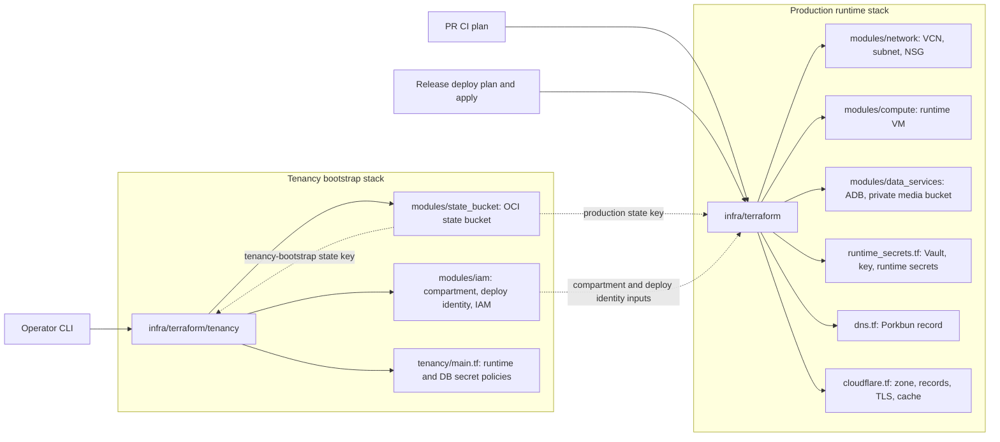
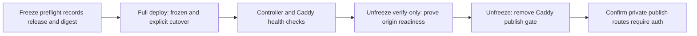

# Terraform and Ansible operational review findings

Status: source inventory complete; final owner review and Phase 8 disposition
remain open for Plan 08-08 Task 5. This register records source, local test,
and production plan evidence. The inventory alone does not close the review.

**Requested setting details:** [publish frozen](#autographs-deploy-publish-frozen),
[explicit cutover](#autographs-deploy-explicit-cutover),
[allow unfreeze](#autographs-deploy-allow-unfreeze),
[verify-only unfreeze](#autographs-publish-unfreeze-verify-only),
[cleanup dry run](#autographs-system-cleanup-dry-run), and
[DNF no-op validation](#security-patching-reboot-validate-dnf-noop).
Each link opens a dedicated producer, action, failure, and disposition trace
in the [detailed operational switch review](#detailed-operational-switch-review).
The [fixture probe adapter census](#fixture-probe-adapter-census) explains what
each of the 15 security-patching test adapters is used to prove.

## Operating boundary

The tenancy root owns the project compartment, deploy identity and policies,
and the OCI state bucket. The production root owns network, runtime compute,
Vault secrets, the staged Oracle database and private media bucket, the
Porkbun record during migration, and the Cloudflare zone, records, strict TLS,
and cache rules. CI plans against production state. Release deployment saves a
plan and applies that exact file. [PR #377](https://github.com/jetsaredim/autographs/pull/377) merged as
`e84d58f` to route reviewed Cloudflare and Porkbun DNS changes through this
ordinary deployment path, with `proxied` as the default and no separate
Cloudflare dispatch job. The new workflow awaits the Release PR production gate.
[PR #378](https://github.com/jetsaredim/autographs/pull/378) removes the extra
deploy-time DNS plan comparison added by PR #377. Destructive managed-resource
actions instead require explicit label approval in CI on both the normal PR
and Release PR; after merge, deployment applies its fresh saved plan. Ansible handles
deploy freeze, runtime
replacement, health and unfreeze, rollback, security maintenance, and cleanup.

The shared invariant for this review is: an ordinary release must preserve the
existing stateful data and DNS ownership, keep publication frozen while the
controller is replaced, and fail visibly before an unreviewed destructive
change. Production state addresses and a sanitized current-input saved plan
are required to prove that invariant; source defaults alone cannot prove it.

### Terraform stack and module map



The two roots have separate state keys in the same OCI Object Storage bucket:
`envs/prod/tenancy-bootstrap.tfstate` and `envs/prod/terraform.tfstate`.
PR CI authenticates and plans only the production root; it initializes and
validates the tenancy root without a live plan. The release workflow also targets the production root. PR #377 removes its
separate manual Cloudflare job while retaining Cloudflare resources in the
production root and state. Tenancy changes require a separate
operator plan against the tenancy bootstrap state before apply.

## Production inputs observed

On 2026-11-15, read-only GitHub variable queries returned
`CLOUDFLARE_MODE=proxied`, `OCI_CREATE_AUTONOMOUS_DATABASE=true`,
`OCI_CREATE_MEDIA_BUCKET=true`, and
`OCI_AUTONOMOUS_DATABASE_IS_MTLS_CONNECTION_REQUIRED=true`.
At that observation, the first three values differed from Terraform's
`off`/`false` defaults. The query alone did not establish the corresponding
Terraform state or plan result. Secret values were not read. PR #354 later
merged and the mTLS variable was removed after its no-change production check.

There are two different cases in this review. **Missing configuration before
PR #358** meant a GitHub Actions variable disappeared while the workflows
supplied their `false` fallback; the Terraform `count` expressions then
evaluated to zero. PR #358 fixed that path. **Deliberately removing a switch
from the code** is a
refactor: its workflow input, root and module arguments, conditional resources
and lookups, outputs, tests, and documentation must change together. Keeping a
resource counted at one can preserve its `[0]` state address; removing `count`
also changes that address and needs a reviewed Terraform `moved` transition.
No finding below treats deletion of a variable declaration alone as a complete
or valid refactor.

## Preliminary findings

| ID | Severity | Finding and evidence | Disposition | Required proof or change |
|---|---|---|---|---|
| IAC-001 | Warning | Before PR #358, CI, release deploy, and the former Cloudflare job substituted `false` when either optional resource-creation GitHub variable was absent. That could reduce the ADB or private media bucket `count` to zero; the database input also gates Vault lookups and rotation (`infra/terraform/main.tf`, `runtime_secrets.tf`, `modules/data_services/main.tf`). | Fixed by [PR #358](https://github.com/jetsaredim/autographs/pull/358) and verified after variable removal | The authenticated PR plan and post-removal read-only production plan both reported no changes. Explicit `false` remains available for initial bootstrap. |
| IAC-002 | Warning | CI planned against production state without making destructive actions an explicit PR review decision. | Gate merged in [PR #371](https://github.com/jetsaredim/autographs/pull/371); final operating review pending | CI reports managed-resource deletion, replacement, and state-forget actions and fails unless the current PR head triggers the `terraform-destructive-plan-approved` label-add event. The normal PR and Release PR each require this approval if destructive actions appear. PR #378 removes the separate deploy-time DNS comparison; production applies its fresh saved plan after merge. PR #371 passed checks and merged as `abc17a0`; its authenticated production plan reported no changes. |
| IAC-003 | Info | Before this cleanup, `create_network` and `create_runtime_instance` defaulted to `true`; explicit `false` would remove managed network/VM resources. No production workflow supplied either input. Runtime recreation uses a separate retry-only taint. | Resolved by [PR #361](https://github.com/jetsaredim/autographs/pull/361), merged as `0b7c20a` | Seven counted resources have `moved` mappings; ingress rule `for_each` keys remain stable. The authenticated production plan reported `0 to add, 0 to change, 0 to destroy`; retry taint accepts both state addresses. |
| IAC-004 | Warning | Before PR #377, the GitHub variable was `proxied` while Terraform and ordinary workflow defaults were `off`; removing it prematurely would have planned deletion of counted Cloudflare resources. | Code merged in [PR #377](https://github.com/jetsaredim/autographs/pull/377) as `e84d58f`; stored variable removed 2026-11-21; post-removal authenticated plan had no changes | Terraform defaults to `proxied`; PR #378 removes the redundant workflow assignment while retaining an optional `dns_only` rollback or fresh-bootstrap `off` override. Reviewed DNS/cache changes use the ordinary saved release plan. Destructive actions require approval in normal and Release PR CI; no deploy-time comparison is intended. [Post-removal Terraform CI](https://github.com/jetsaredim/autographs/actions/runs/44908578055/job/136859340147) reported no changes. Later production deployment of the new workflow remains unproven. |
| IAC-005 | Info | Full deploy requires `autographs_deploy_publish_frozen` and `autographs_deploy_explicit_cutover`; unfreeze uses `autographs_deploy_allow_unfreeze`, and restart handlers are suppressed during explicit cutover. | Retain | The workflow sets frozen=true for full deploy, and role assertions reject false. The unfreeze playbook alone sets frozen=false with allow_unfreeze=true; `publish_freeze.yml` rejects false without that override. Explicit cutover suppresses restart handlers until the workflow's health gate; production and render fixtures cover both freeze states. Removing one flag would weaken a distinct assertion or require a broader operation-state contract. |
| IAC-006 | Info | `security_patching_reboot_validate_dnf_noop` defaults true and is set false in reboot-state fixtures; production validation tasks use it to gate DNF no-op checks. | Retain as fixture seam | No production workflow overrides the true role default. The false fixture path tests reboot-state classification without running DNF, while true fixtures exercise the no-op validation and failure behavior; `security-reboot-state-validate-test.yml` and `validate_reboot_state.yml` cover both values. |
| IAC-007 | Info | `create_runtime_instance` formerly described the retired Node runtime, and the Ansible deploy role still stopped and removed the old `autographs-app` unit, quadlet, and container. | Resolved by [PR #376](https://github.com/jetsaredim/autographs/pull/376), merged as `b724d75` | The three obsolete cleanup tasks and active runbook instructions were removed. The controller contract test now asserts their absence; Ansible syntax/lint, controller CI, and two review rounds passed. |

IAC-001 and IAC-002 share the stateful-resource preservation invariant. The
source and production-plan resolution for IAC-001 is recorded below. IAC-002
now has a CI plan review check over the saved plan JSON in `.github/workflows/ci.yml`.
It reports deletes, replacements, and state forgets, and fails unless a
maintainer adds `terraform-destructive-plan-approved`
to the PR after reviewing the plan. Only the label-add event accepts a
destructive plan; a new commit fails until the label is removed and re-added
after review of the new plan.
In-place updates and creates pass the check. The ordinary release workflow
does not repeat this general check; it applies a saved plan. PR #377 added a
DNS-only deploy comparison, and PR #378 removes that extra gate.
The authenticated
[PR #371 Terraform check](https://github.com/jetsaredim/autographs/actions/runs/44461153658/job/135347968960)
reported `No changes. Your infrastructure matches the configuration.` under
the earlier strict policy. The revised gate passed PR checks and merged as
`abc17a0`. Final IAC-002 closure requires owner review of the completed
operating-contract inventory and its remaining limitations.

PR #354 adds `prevent_destroy` to the ADB, private media bucket, and tenancy
state bucket. This blocks a plan that destroys or replaces one of these
resources while its resource block remains configured, including a counted ADB
or media bucket whose `count` becomes zero. It does not protect a resource if
its entire configuration is removed. The PR #371 CI review check exposes this
case and requires the review label, while the release workflow does not repeat
the general guard. The runtime VM keeps its intentional taint-and-replace
recovery path only on an explicit retry.

### IAC-001 resolution and production proof

The owner proposed making `true` the code default for the two production
resource-creation switches and then removing their GitHub Actions variables.
That is a coherent simplification if it changes **both** the Terraform root
defaults and the `vars.* || 'false'` fallbacks in CI, release deploy, and the
Cloudflare operator workflow. Changing only Terraform's defaults would have no
effect in those workflows because they always set `TF_VAR_*`. An explicit
`false` remains available for the documented initial bootstrap before Vault
secrets and the Object Storage namespace are ready.

The sequence was completed: PR #358 merged as `797e387` after all required
checks passed. Its [authenticated Terraform CI job](https://github.com/jetsaredim/autographs/actions/runs/44111310814/job/134137340094)
reported `No changes` with both GitHub variables still `true`. The two
repository variables were then deleted. The read-only
[main operator plan run 44112638567](https://github.com/jetsaredim/autographs/actions/runs/44112638567)
reported `No changes`, `Cloudflare change count: 0`, and `Plan only: no
Terraform apply was run`. Its checked-out commit was `797e387`; the workflow
required the existing Cloudflare state addresses before planning. This proves
the missing-variable workflow fallback retains the managed resources under
the current production inputs. The counted `[0]` resource addresses and
explicit `false` bootstrap overrides are unchanged.

A later removal of the Terraform switches themselves must update
their conditional consumers and move each affected counted instance, such as
`module.data_services.oci_database_autonomous_database.catalog[0]` and
`module.data_services.oci_objectstorage_bucket.media[0]`, to its new address
with reviewed `moved` blocks or an equivalent state migration. That later PR
must show a no-destroy, no-recreate production plan before apply. IAC-002's
broader destructive-plan policy is implemented in PR CI; final owner disposition
remains open.

This closes IAC-001. IAC-002 remains open.

## Switch census and direct boundaries

This census covers root Terraform Boolean/mode inputs, production Ansible
Boolean/mode inputs found in role defaults or workflow calls, and maintenance
workflow dispatch modes. Module inputs that simply forward a root value are
traced with the root input. Fixture probe overrides remain in the role-task
inventory until their supported test paths are classified. Effects described
for `false` or missing inputs refer to the code as it exists today, not to a
proposed refactor that removes the input and its conditional consumers.

| Switch or mode | Producer and current/default value | Direct consumer and unsafe transition | Review state |
|---|---|---|---|
| `create_network` | Removed from root and module in PR #361; no workflow override existed | VCN, subnet, gateway, route table, NSG, and egress rule move from `[0]` to uncounted addresses; ingress rule keys stay unchanged. | IAC-003; authenticated plan has no provider changes. |
| `create_runtime_instance` | Removed from root and module in PR #361; no workflow override existed | VM moves from `[0]` to uncounted address; image lookup still runs when no explicit image OCID is supplied. Retry-only `recreate_runtime_instance` remains. | IAC-003; authenticated plan has no provider changes. |
| `create_autonomous_database` | Removed from root, module, and workflows in the ADB bootstrap cleanup | A moved block maps the counted ADB state address to the uncounted resource; the reviewer-gated `bootstrap_secrets` operation owns fresh Vault setup. | Require authenticated no-destroy production plan before merge. |
| `create_media_bucket` | Removed from the root, module, examples, and all three workflow environments by [PR #360](https://github.com/jetsaredim/autographs/pull/360) | The private bucket remains managed from the first runtime-root apply; its namespace must be supplied. A `moved` block maps the existing `[0]` state address to the uncounted address. | Authenticated PR plan: `0 to add, 0 to change, 0 to destroy`; no apply. |
| `assign_public_ip` | Fixed `true` in the compute resource; root and module inputs removed | VM VNIC retains its public IP. | PR production plan to verify. |
| ADB `is_free_tier` | Hardcoded `true` in the data services resource; former root/module input removed | Fixes the database to Oracle Always Free. The existing counted resource address is unchanged. | PR CI production plan returned no changes. |
| ADB `is_mtls_connection_required` | Hardcoded `true` in the data services resource; former GitHub/workflow and Terraform inputs removed in PR #354 | Requires wallet-based connections. Existing counted resource address is unchanged. | Local validation and PR CI production no-change plan passed. Remove the now-unused GitHub variable after merge. |
| Media bucket `versioning` | Hardcoded `Enabled` in the data services resource in PR #354 | Preserves private Object Storage recovery posture. Existing counted resource address is unchanged. | Local validation and PR CI production no-change plan passed. |
| Root and tenancy OCI `auth` | Terraform default `APIKey`; accepts `APIKey`/`SecurityToken` | Selects OCI provider authentication for production or bootstrap state. | Confirm each root's operator entry point and credential source. |
| State bucket `storage_tier` | Hardcoded `Standard` in the state bucket module in PR #354 | Keeps Terraform state promptly retrievable. Existing uncounted resource address is unchanged. | Local validation and authenticated tenancy-root no-change plan passed on 2026-11-15; no apply. |
| `cloudflare_mode` | GitHub variable removed 2026-11-21; Terraform default `proxied` merged in PR #377; PR #378 removes the workflow fallback | Counts zone, records, TLS, rules; `dns_only` preserves the zone but changes the app A-record proxy flag. | IAC-004; post-removal authenticated no-change plan passed; later release deploy verification pending. |
| `bootstrap_runtime_secrets` | Root Terraform Boolean defaults `false`; reviewer-gated `bootstrap_secrets` dispatch sets `true` in `deploy.yml` | `false` reads password/readiness bundles and can attach ADB rotation; `true` omits those reads and rotation during targeted Vault creation before ADB exists. Using `true` in an ordinary deploy would bypass readiness, so only the scoped bootstrap job supplies it. | Retain. Normal path has a production no-change plan; bootstrap guards and `test_release_workflow.py` cover the true route, with no live bootstrap claim. |
| `runtime_secret_values_ready` | Derived from three Vault CURRENT-version checks during normal plans | Blocks ADB creation/update until the generated DB password and manually populated secrets are ready. Bootstrap skips the reads only during its saved targeted plan. | Preserve fail-closed precondition; verify missing and bootstrap versions. |
| `autographs_deploy_publish_frozen` | Role default and deploy input `true`; unfreeze sets `false` | Full-deploy assertion and exact Caddy publish gate. | IAC-005; trace as one cutover contract. |
| `autographs_deploy_explicit_cutover` | Role default `true` | Full-deploy assertion and restart-handler suppression. | IAC-005; trace role notifications and fixtures. |
| `autographs_deploy_allow_unfreeze` | Absent/false by default; unfreeze sets `true` | Allows removal of publish gate when frozen flag becomes false. | IAC-005; verify failure rescue and no bypass. |
| `autographs_publish_unfreeze_verify_only` | Unfreeze default `false`; deploy invokes true then false | First invocation checks origin readiness without removing gate; second removes it after health. | Trace both paths and failed second step. |
| `autographs_publish_freeze_fixture_mode` | Preflight default `false`; disposable `test_publish_freeze_deploy.py` supplies `true` | `false` runs production systemd Caddy restart and controller stop; `true` substitutes local Caddy reload and simulated stop only after local connection, `media-probe.invalid`, temporary path, and environment assertions. | Retain test adapter. Source and Python fixture cover the branch; CI syntax-checks the playbook but does not execute this integration fixture. |
| `autographs_publish_unfreeze_fixture_mode` | Unfreeze default `false`; disposable `test_publish_freeze_deploy.py` supplies `true` | `false` uses systemd on success/rescue; `true` reloads local fixture Caddy under the same local/domain/path/environment guard. | Retain test adapter; source and Python fixture cover both branches, with no CI behavior-run claim. |
| `autographs_deploy_fixture_mode` | Deploy role defaults to `false`; `publish-freeze-role-reaudit-test.yml` sets `true` | `false` starts/restarts production Caddy under cutover; `true` uses guarded local fixture reload in success and rescue, preventing a fixture from touching production services. | Retain test adapter; CI syntax/lint only for this fixture, behavior execution remains unproven here. |
| `autographs_system_cleanup_dry_run` | Role default string `"false"`; image-cleanup workflow input | `true` reports selected images and a would-prune message; `false` removes selected old images and prunes dangling images. Scheduled local cleanup uses `false`; manual input may preview. | Retain; preview and execute are distinct operator choices. |
| `security_patching_reboot_validate_dnf_noop` | Role default `true`; fixture overrides true/false | Gates DNF no-op proof before reboot cleanup. | IAC-006; verify production and test seam. |
| `security_patching_require_request_instance_match` | Target-scope helper defaults `false`; approval, update/reboot classification, and result tasks pass `true` | `false` still requires a configured nonempty live target group for scanner publication; `true` also requires the approved issue host set to match it exactly before mutation or success reporting. | Retain. Target-scope fixture passed locally with its declared inventory; production apply/reboot runs cover selected true paths. |
| `security_patching_ksplice_apply_mode` | Patch task fixes `report_only`; result template reports it | No mutating Ksplice mode is reachable; changing this value would alter the maintenance contract and needs a separate reviewed plan. | Retain as fixed reporting value; update-result fixture and Python source test cover `report_only`. |
| Security update/reboot approval labels | GitHub issue labels and approved workflow events | Separate update and reboot paths validate current scanner state before mutation. | Trace issue update, approval removal, cleanup, and retry. |
| `recreate_runtime_instance` | Deploy workflow dispatch Boolean, default false | Retry-only taint of tracked compute address before saved plan. | Verify replacement gate and rollback path. |
| CI `DESTRUCTIVE_PLAN_APPROVED` | False for ordinary PR events; true only on a fresh `terraform-destructive-plan-approved` label-add event for the current PR head | False rejects managed deletes, replacements, and state forgets; true permits the reviewed plan to pass CI, with a new commit requiring a fresh label event. | Retain; `test_release_workflow.py` exercises the jq action classifier and label event gate; PR #371 passed and merged. |
| Release `operation` | Push to `main` follows normal release; PR #377 retains manual `retry`, `rollback`, and `bootstrap_secrets` | Retry can taint/replace the VM, rollback selects a verified controller digest, and bootstrap targets only Vault resources. Cloudflare changes use the ordinary release plan/apply. PR #378 removes the additional DNS comparison; destructive plans require approval in normal and Release PR CI. | PR #377 passed local tests, authenticated Terraform CI, and second review; deployment proof remains pending. |
| Cloudflare `operation` | Historical manual `cloudflare_plan` or `cloudflare_apply`; removed by PR #377 | The same Terraform root and state remain. The ordinary release logs changed Terraform addresses/actions and applies its fresh saved plan after merge. | Superseded by the owner-selected ordinary deploy path after PR review; keep historical migration evidence. |
| Historical v0.5.0 `operation` | `complete-v0.5.0.yml` manual `complete` or `finalize` | `complete` requires exact frozen release and origin state before unfreeze; `finalize` requires a prior successful unfreeze run before GitHub bookkeeping. Current proxied DNS likely fails its fixed origin-IP guard. | Retain as historical, fail-closed record pending a separate retirement decision; do not present as current recovery procedure. |
| Controller provider modes | Deploy defaults `oracle` and `oci-instance-principal`; role/config also allow `local` | Production selections keep Oracle metadata and private OCI originals; local values route to nonproduction adapters and must not be used for production release. | Retain for local/CI work; deploy assertions and configuration contract guard production values. |
| Image cleanup `dry_run` / `remote_operation` | Scheduled or manual `image-cleanup.yml`; manual options `inventory`/`delete` | Scheduled local Podman cleanup gets `dry_run=false` and may prune; scheduled GHCR remains dry-run. Manual GHCR deletion requires explicit `delete`; the manual local dry-run input is independent. | Trace both local and remote actions and protected tags. |

## Detailed operational switch review

This section traces the six settings requested by the owner from their
producer to the action or refusal they control. The [deployment workflow](../.github/workflows/deploy.yml)
is the entry point for the first four. Its ordinary sequence is:



### `autographs_deploy_publish_frozen`

**Purpose and producer.** The [deploy role default](../deploy/ansible/roles/autographs_deploy/defaults/main.yml)
is `true`, and the production workflow explicitly passes `true` to the full
Ansible deployment. The [role's first assertion](../deploy/ansible/roles/autographs_deploy/tasks/main.yml)
rejects `false` before runtime files change. A preceding freeze preflight
records the exact release tag, controller digest, old process, static pointer,
and publication state. The full role checks that record again before routing
to the replacement controller.

**Effect.** The [shared publish-freeze task](../deploy/ansible/roles/autographs_deploy/tasks/publish_freeze.yml)
inserts a managed Caddy block ahead of the general admin API proxy. It returns
503 with `Cache-Control: no-store` for `/admin/api/publish/full` and
`/admin/api/publish/incremental`; `/admin/api/publish/status` remains proxied
to the controller with a frozen header. The role starts/restarts Caddy and
checks that both mutating routes still return 503. A cutover route failure
restores the saved frozen Caddyfile where available and retains the durable
freeze record. The release workflow will not run unfreeze unless deployment
health passes.

**Reachability and decision.** `false` is used by the dedicated unfreeze
playbook, not by a full deployment. Keep the explicit frozen assertion while
the full role and unfreeze playbook share the Caddy task. This is a publication
state guard, not a routine deploy tuning option.

### `autographs_deploy_explicit_cutover`

**Purpose and producer.** The deploy role defaults this to `true`; the
production workflow does not override it. The same first role assertion
requires `true`, so `false` cannot complete a full deploy. The
[handler file](../deploy/ansible/roles/autographs_deploy/handlers/main.yml)
contains restart/reload handlers conditional on `not explicit_cutover`.

**Effect.** Template and quadlet tasks can notify those handlers, but they do
not restart Caddy or the controller during the required explicit-cutover
path. The role instead reloads systemd, starts the reviewed controller,
compares its running image ID with the verified image, checks release/source
health, and then restarts Caddy with frozen routes. The Caddy cutover block
checks preview and public origin behavior, including the frozen publish
responses. Its rescue path restores the old frozen Caddyfile and fails while
preserving the freeze record.

**Reachability and decision.** The `false` handler path is effectively
unreachable through the current full role because its entry assertion refuses
it. The present value documents and enforces the cutover contract, but the
Boolean and conditional handlers could be simplified in a separate reviewed
refactor if all producers and tests move to an unconditional explicit cutover.
That refactor is not needed to close the current inventory.

### `autographs_deploy_allow_unfreeze`

**Purpose and producer.** There is no permissive role default. The
[unfreeze playbook](../deploy/ansible/playbooks/publish-unfreeze.yml) sets
`autographs_deploy_publish_frozen=false` and
`autographs_deploy_allow_unfreeze=true` together. The shared Caddy task
asserts `publish_frozen or allow_unfreeze` before it can remove the gate.

**Effect and failure.** This flag authorizes the gate-removal branch of that
shared task; it does not itself remove the gate or restart Caddy. The unfreeze
playbook must first match the durable freeze record to the exact release and
image digest, revalidate current pointer/manifest/history/markers and both
origins, and confirm the old publisher process is gone. If a caller sets
`publish_frozen=false` without the allowance, the task fails before editing
the Caddyfile. If later unfreeze checks fail, the rescue block restores the
frozen Caddyfile, restarts Caddy, and keeps the durable record.

**Decision.** Keep as a narrow authorization on the shared task. It is only
expected from the dedicated unfreeze playbook, not from full deployment.

### `autographs_publish_unfreeze_verify_only`

**Purpose and producer.** The unfreeze playbook defaults this to `false`.
After the full deploy and public/controller health checks, the workflow calls
that playbook twice for the same release, digest, and source revision: first
with `true` in “Verify frozen origin readiness,” then with `false` in
“Explicitly unfreeze verified production publication.” The second call is
conditional on a successful first call.

**True path.** The playbook checks the freeze record and current release
identity, probes public HTTPS and the private preview origin, and tests exact
media marker denial. Its disposable probe file and marker are removed. The
block that edits the Caddy gate is skipped, so publication stays frozen.

**False path and failure.** The playbook repeats the readiness checks, saves
the frozen Caddyfile, removes the managed gate, restarts Caddy, and expects
unauthenticated full/incremental publish requests to return 401 or 403 rather
than 503. It also checks private status auth, current 200s, exact-marker 404s,
and retained-old-media 200s on public and preview origins. Only after all
postchecks does it record the approved digest and remove the freeze record.
Its rescue block restores frozen Caddy and leaves that record for retry. The
release completion gate requires the real unfreeze step to succeed.

**Decision.** Keep: `true` is a non-opening proof step; `false` is the guarded
mutation. The two calls are intentional even though they repeat checks.

### `autographs_system_cleanup_dry_run`

**Purpose and producer.** The [cleanup role default](../deploy/ansible/roles/autographs_system_cleanup/defaults/main.yml)
is the string `"false"`. In [image-cleanup.yml](../.github/workflows/image-cleanup.yml),
the manual `dry_run` input defaults to `"true"`; the weekly schedule has no
input, so its expression falls back to `"false"`. This variable affects local
Podman cleanup on the VM. GHCR inventory/deletion uses separate
`remote_operation` and `GHCR_CLEANUP_DRY_RUN` controls.

**Selection before mutation.** The role requires active controller image
metadata from `app.env`, reads the previous image, containers, and local
images, then calls `select-removable-images.py`. That selector protects the
current and previous image, images attached to containers, configured
protected tags, and the newest configured count (default three) for the
controller repository. Missing active image metadata stops cleanup.

**True versus false.** Both paths log selected candidates. `true` prints
“Would remove” and “Would run podman image prune” messages. `false` runs
`podman rmi --force` only on selected IDs, then `podman image prune --force`
for dangling images. There is no automatic rollback after image deletion;
retained/protected images are the recovery margin. A manual GHCR `delete`
does not change this local dry-run input, and a local `false` does not by
itself request GHCR deletion.

**Decision.** Keep the preview path, but treat the weekly schedule as an
intentional mutating maintenance job. The manual entry defaults to preview.

### `security_patching_reboot_validate_dnf_noop`

**Purpose and producer.** The [security-patching role default](../deploy/ansible/roles/security_patching/defaults/main.yml)
is `true`; production workflows do not set it to `false`. The
[reboot-state validation task](../deploy/ansible/roles/security_patching/tasks/validate_reboot_state.yml)
first checks that approved advisory IDs match the current scan, that the
authoritative next action is `reboot`, and that finding packages are eligible
for the reboot path.

**True path.** It runs `dnf --assumeno upgrade-minimal --security` limited to
approved advisories. The result must have exit code zero and a “nothing to
do” or “no packages marked” signal. A non-no-op result writes bounded
failure context without dumping the full DNF output. Only a proven no-op
permits target-kernel resolution and contributes to
`security_patching_reboot_preflight_ready`, which must be true before reboot
mutation.

**False path and fixture seam.** `false` skips the live DNF probe, but it also
leaves `security_patching_reboot_dnf_noop_proven=false`; therefore it cannot
make the reboot preflight ready or authorize a production reboot. The
reboot-state fixture uses `false` to test classification branches without
calling DNF. Other fixture cases use `true` with a bounded probe override to
test no-op success and refusal. Keep the production default; this is a test
seam, not an operator bypass.

### `runtime_secret_values_ready` (related Terraform gate)

This is a Terraform-derived readiness check, not a GitHub Secret. Before the
first normal ADB create/update, Vault must show CURRENT versions greater than
one for the manually populated admin password hash and wallet password, and
greater than one for the DB password unless its first version was generated
automatically. The `bootstrap_secrets` workflow uses the GitHub Secrets to
populate untouched Vault placeholders under the separate secret-audit gate.
Merely setting GitHub Secrets does not make the normal Terraform precondition
pass: the Vault versions must be present. Sources:
[runtime_secrets.tf](../infra/terraform/runtime_secrets.tf),
[data_services/main.tf](../infra/terraform/modules/data_services/main.tf), and
[deploy.yml](../.github/workflows/deploy.yml).

### Fixture probe adapter census

The 15 named security-patching probe adapters below have two reachable states:
absent or non-mapping in production invokes the real host probe; a
fixture-supplied mapping substitutes a bounded command result. The adapters
let local tests present safe, unsafe, and changed host evidence without
depending on the test runner's RPM database, bootloader, or kernel. They do
not disable filesystem checks or provide a supported production operation
mode. Each listed fixture passed locally on 2026-11-20; CI syntax-checks the
playbooks but does not run these behavior fixtures. The first eight adapters
classify findings and the existing boot posture. The remaining seven control
reboot approval and the final check immediately before boot mutation.

| Adapter | What it lets the fixture establish | Real probe and direct consumer | Fixture evidence |
|---|---|---|---|
| `security_patching_classification_dnf_probe_override` | Whether the current advisory set still has package work, is already a DNF no-op, or has an unsafe/unrecognized result. This determines the reported next action before an approval issue is treated as actionable. | Advisory-scoped `dnf --assumeno upgrade-minimal --security` in `classify_findings.yml`. | `security-finding-classification-validate-test.yml` exercises work, no-op, and unsafe outputs. |
| `security_patching_installed_package_names_probe_override` | Whether RHCK packages remain installed alongside the expected UEK packages, including a missing or inconsistent package inventory that must be reported rather than treated as healthy. | `rpm -qa` package-name inventory in `kernel_posture.yml`. | `security-kernel-posture-validate-test.yml` supplies complete and drifted inventories. |
| `security_patching_running_kernel_probe_override` | Which kernel is actually running now, so the scan can distinguish a booted UEK from an old or unexpected kernel even if packages are installed. | `uname -r` in `kernel_posture.yml`. | `security-kernel-posture-validate-test.yml` varies the running release. |
| `security_patching_default_kernel_probe_override` | Which image the bootloader would select on the next reboot; a good running kernel alone cannot prove the next boot is safe. | `grubby --default-kernel` in `kernel_posture.yml`. | `security-kernel-posture-validate-test.yml` supplies matching and inconsistent defaults. |
| `security_patching_running_kernel_owner_probe_override` | Whether the running kernel image belongs to an installed UEK RPM rather than being an unowned or mismatched file. | `rpm -qf` for the running image in `kernel_posture.yml`. | `security-kernel-posture-validate-test.yml` covers valid, missing, and mismatched ownership. |
| `security_patching_default_kernel_owner_probe_override` | Whether the default-boot image belongs to an installed UEK RPM, protecting the next reboot even when the currently running image is valid. | `rpm -qf` for the default image in `kernel_posture.yml`. | `security-kernel-posture-validate-test.yml` covers valid, missing, and mismatched ownership. |
| `security_patching_kernel_boot_entry_probe_overrides` | Supplies separate boot-entry results for `running` and `default`, so the fixture can prove each image has an exact boot entry and concrete initramfs rather than treating either kernel name as sufficient. | `kernel_posture.yml` selects a mapping by label and passes it to `inspect_kernel_boot_entry.yml`. | `security-kernel-posture-validate-test.yml` provides valid and missing-entry cases. |
| `security_patching_kernel_entry_probe_override` | Delivers the selected running or default boot-entry result to the shared parser; invalid image or initramfs lines must yield an unsafe entry result. This is the inner per-entry adapter, not a second independent host probe. | `grubby --info=<image>` in `inspect_kernel_boot_entry.yml`. | Reached through `security-kernel-posture-validate-test.yml` and the outer mapping. |
| `security_patching_reboot_dnf_noop_probe_override` | Proves that an approved reboot is only a reboot follow-up: the approved advisories must have no pending DNF package transaction. Actionable work or ambiguous output blocks reboot approval. | Advisory-scoped `dnf --assumeno upgrade-minimal --security` in `validate_reboot_state.yml`. | `security-reboot-state-validate-test.yml` supplies no-op and still-actionable results. |
| `security_patching_reboot_kernel_candidate_probe_override` | Selects the newest installed UEK core package by RPM ordering as the proposed reboot target; missing or malformed candidate output must refuse selection. | `dnf repoquery --installed --latest-limit=1` in `resolve_reboot_kernel.yml`. | `security-reboot-kernel-selection-validate-test.yml` covers valid and invalid candidates. |
| `security_patching_reboot_kernel_owner_probe_override` | Proves the proposed target kernel image is owned by an installed UEK package before choosing it as a boot target. | `rpm -qf` for the selected image in `resolve_reboot_kernel.yml`. | `security-reboot-kernel-selection-validate-test.yml` covers valid and invalid ownership. |
| `security_patching_reboot_kernel_boot_entry_probe_override` | Proves the proposed target has an exact boot entry pointing to its image and an existing concrete initramfs before any default-boot change. | `grubby --info=<selected image>` in `resolve_reboot_kernel.yml`. | `security-reboot-kernel-selection-validate-test.yml` covers valid and invalid entries. |
| `security_patching_reboot_premutation_candidate_probe_override` | Re-queries the newest UEK immediately before changing the boot default; a newly installed or changed target since approval must stop the mutation. | `dnf repoquery --installed --latest-limit=1` in `revalidate_reboot_kernel.yml`. | `security-reboot-kernel-selection-validate-test.yml` exercises pre-mutation candidate drift. |
| `security_patching_reboot_premutation_owner_probe_override` | Rechecks that the selected kernel image still has the expected RPM owner immediately before boot mutation; ownership drift must stop the reboot path. | `rpm -qf` for the selected image in `revalidate_reboot_kernel.yml`. | `security-reboot-kernel-selection-validate-test.yml` exercises pre-mutation owner drift. |
| `security_patching_reboot_premutation_boot_entry_probe_override` | Rechecks the selected image's exact boot entry and initramfs before mutation; changed or missing boot evidence must stop the reboot path. | `grubby --info=<selected image>` in `revalidate_reboot_kernel.yml`. | `security-reboot-kernel-selection-validate-test.yml` exercises pre-mutation boot-entry drift. |

### Fixed-policy input validation

The Always Free change removes one root/module pass-through and fixes the
existing resource argument to `true`. It does not change the `count` expression
or resource address. The production tfvars example no longer advertises a paid
tier override. Each additional input below was changed and validated locally
one at a time. None of the changes alters a resource `count`, `for_each`, or
Terraform address. The PR CI authenticated production plan on
[run 43746652748](https://github.com/jetsaredim/autographs/actions/runs/43746652748)
returned no changes. Local validation used the pinned providers with an
isolated `TF_DATA_DIR` and `-backend=false`; that local validation did not read
production or tenancy state.

| Former input | Fixed resource value and local check | Live proof / follow-up |
|---|---|---|
| `autonomous_database_is_mtls_connection_required` | ADB `is_mtls_connection_required = true`; production-root `terraform validate` passed after removing the three workflow inputs and updating wallet docs. | PR CI production plan returned no changes. Remove unused GitHub variable only after merge and recheck. |
| `autonomous_database_db_workload` | ADB `db_workload = "OLTP"`; production-root `terraform validate` passed. | PR CI production plan returned no changes. |
| `autonomous_database_license_model` | ADB `license_model = "LICENSE_INCLUDED"`; production-root `terraform validate` passed. | PR CI production plan returned no changes for this billing-related argument. |
| `autonomous_database_data_storage_size_in_tbs` | ADB `data_storage_size_in_tbs = 1`; production-root `terraform validate` passed. OCI ignores this sizing request on Always Free databases; it is not the effective storage size. | PR CI production plan returned no changes. |
| `media_bucket_versioning` | Private bucket `versioning = "Enabled"`; production-root `terraform validate` passed. | PR CI production plan returned no changes. |
| `state_bucket_storage_tier` | State bucket `storage_tier = "Standard"`; tenancy-root `terraform validate` passed. | Authenticated plan against `envs/prod/tenancy-bootstrap.tfstate` returned no changes on 2026-11-15; no apply. |

The remaining database resource-presence switch determines a supported
bootstrap path; the network and runtime switches had no production false-state
use and are being removed with state-preserving moves. The media bucket had no
secret-readiness dependency, so its switch was removed with the
state-preserving move and namespace precondition below.

### Media bucket conditional retirement

**Invariant:** The existing private bucket keeps its production identity and
Terraform ownership, with no create, update, replacement, or destruction. A
fresh runtime-root apply requires the real Object Storage namespace and may
create the bucket before the manual Vault secrets are ready.

The direct producer was root `create_media_bucket`, forwarded into
`module.data_services` and set as `TF_VAR_create_media_bucket` by CI, release
deploy, and the manual Cloudflare job. Its consumers were the bucket `count`,
the namespace precondition, and documentation/example bootstrap overrides.
The bucket name and namespace outputs do not depend on the Boolean. Terraform
now manages the bucket unconditionally, rejects an empty namespace, and maps
`module.data_services.oci_objectstorage_bucket.media[0]` to
`module.data_services.oci_objectstorage_bucket.media` with a `moved` block.
At the time of this move, release deploy rejected DNS changes and the manual
Cloudflare job rejected non-Cloudflare changes. PR #377 changes that later
operating contract; the original state move required a reviewed production plan.

The previous `false` state was used only to postpone bucket creation until the
operator knew the namespace; there is no secret or data lookup dependency.
At the time of PR #360, fresh bootstrap supplied the namespace before its first runtime-root apply
and kept `create_autonomous_database=false` for Vault preparation. Local
Terraform formatting/validation passed. The authenticated
[PR #360 Terraform CI job](https://github.com/jetsaredim/autographs/actions/runs/44142634487/job/134249244704)
reported the exact move from `media[0]` to `media` and `Plan: 0 to add, 0 to
change, 0 to destroy`. No apply ran. The move requires no bucket replacement
or loss of Terraform management. The remaining PR checks must pass before
merge.

### Network and runtime conditional retirement

The network/VM switch removal is a separate contract change. Production and
the local tfvars example used `true`; CI and release deploy supplied no
override. The `false` paths could omit the VCN, subnet, gateway, route table,
NSG/rules, VM, and image lookup, but no current operator runbook uses them for
bootstrap or recovery. The supported VM replacement path is the explicit
`recreate_runtime_instance=true` retry input.

**Network and VM invariant:** Keep the existing VCN, subnet, gateway, route
table, NSG/rules, and VM identities and Terraform ownership. The migration
must make zero provider-side changes. The VCN, gateway, route table, NSG,
egress rule, subnet, and VM receive `[0]`-to-uncounted `moved` blocks. SSH,
HTTP, and HTTPS ingress rules keep their existing `for_each` CIDR keys.
Module outputs and network/VM resource references use the new addresses. The
Oracle Linux image lookup still has a count only for the explicit-image versus
latest-image choice; production's current lookup remains reachable.

The release workflow consumes the VM address in its deliberate taint path.
That path accepts either the old `[0]` or the new uncounted state address
during the first migration deploy, then plans the same requested replacement.
The routine Terraform plan and output values passed to Ansible remain direct
reporting/action consumers; the then-current DNS guard and operator plan also
consumed the address before PR #377 proposed their retirement. Local
Terraform formatting and validation, the workflow retry contract test, and
an authenticated production plan are required. The
[PR #361 Terraform check](https://github.com/jetsaredim/autographs/actions/runs/44186083100/job/134402863195)
reported all seven network/VM moves and `Plan: 0 to add, 0 to change, 0 to
destroy`. The earlier media bucket move also appeared because no production
apply has persisted that state-only migration yet. The PR must still pass all
remaining CI gates before merge; the next normal release apply will persist
the state moves.

### Database conditional retirement boundary

The ADB resource is now unconditional. A `moved` block maps
`module.data_services.oci_database_autonomous_database.catalog[0]` to its
uncounted address. Fresh setup is an explicit `bootstrap_secrets` dispatch in
`deploy.yml`, gated by the `secret-audit` environment reviewer and `main` branch
policy. Its saved target plan permits only new Vault, key, and secret resources;
the bootstrap script replaces only exact version-1 manual placeholders from
the two GitHub Secrets. Normal deploy verifies exact GitHub/Vault equality and
fails before planning on drift. Neither path writes the OCI-generated database
password.

The generated password secret discovers an existing ADB by its exact display
and DB names instead of referencing the managed ADB resource. This removes
the secret-to-ADB graph edge during the targeted bootstrap. Normal deployment
creates ADB after the manual versions are ready, then runs a second saved plan
that may only attach the expected `P90D` ADB rotation target. Production plan
evidence must prove the state move has no provider changes before merge; a
fresh-tenancy live bootstrap remains operator-triggered and is not implied by
the production no-change plan.

### Remaining defaults and current GitHub overrides

On 2026-11-15, the two Terraform root variable files, local operator tfvars,
three production Terraform workflow inputs, and current GitHub Actions variable
names/values were compared. "Same" below means the current explicit value
equals the code fallback; it does not prove the value was never changed
historically or that other operators have no private overrides.

| Input group | Current observation | Contract and disposition |
|---|---|---|
| `create_network`, `create_runtime_instance` | Production defaults and local tfvars were `true`; no GitHub workflow override. | Their source and direct consumers are now being removed with reviewed `moved` transitions. PR CI production-state plan must show no changes before merge. |
| `assign_public_ip` | Fixed `true` in the compute resource; no GitHub workflow override. | Root and module inputs were removed; confirm the existing VM has no production plan change. |
| `runtime_boot_volume_size_gbs` | Production default, local tfvars, and example are `50`; no GitHub Actions variable or workflow override exists. | Keep the Terraform input configurable and retain the `50` default. No boot-volume sizing cleanup is proposed. |
| `project_name`, `environment` | Defaults and local tfvars match in both roots; no production workflow override. | Feed tags and derived OCI, DNS, and media names. Preserve cross-root alignment; a change affects resource identity and secret lookups. |
| `region`, `home_region`, network CIDRs and ingress CIDRs | Current local values match their defaults; no production workflow override. | These are location and network policy inputs. Retain operator control rather than treating the current values as proof of fixed policy. |
| Tenancy identity and state-bucket names | Most local values match defaults or rely on defaults; the tenancy root has no GitHub workflow input. | They identify existing IAM and state resources. Review each name against tenancy state before any hardcoding. |
| `runtime_image_ocid` | Default empty; no current GitHub variable, but workflows still pass the empty value. | Empty selects the Oracle Linux image lookup. It is a meaningful lookup mode, not a fixed image identifier. |

The production root now looks up the project compartment under the tenancy
by `${project_name}-${environment}-cmp`. The deploy group already has `inspect compartments
in tenancy`; the lookup removes the manually copied `OCI_COMPARTMENT_OCID`
workflow input. Keep the stored variable until PR #354 merges because `main`
still requires that Terraform input. PR CI run `43777689199` read the OCI
compartment data source and reported `No changes` on commit `76a54cf`.
Remove the stored variable after merge.

The earlier review identified `DEPLOY_SSH_USER` and `DEPLOY_PATH` as stored
values equal to workflow fallbacks. The owner now chose Ansible ownership for
the deployment root: [PR #379](https://github.com/jetsaredim/autographs/pull/379)
removes the unused Terraform `runtime_deploy_path` input, gives Ansible one
`/opt/autographs` default across deploy and recovery playbooks, and preserves
an optional GitHub override. PR #379's authenticated Terraform plan reported
`No changes`; the stored `DEPLOY_PATH` was then removed on 2026-11-21.
The same PR now removes Terraform's unused `runtime_deploy_user` input,
makes `opc` Ansible's shared SSH user default, and retains an optional
`DEPLOY_SSH_USER` GitHub override for all active Ansible workflows. Its
authenticated plan reported `No changes`; the stored `DEPLOY_SSH_USER=opc`
variable was then removed and verified absent on 2026-11-21. The three runtime sizing variables
`OCI_RUNTIME_SHAPE`, `OCI_RUNTIME_OCPUS`, and `OCI_RUNTIME_MEMORY_GBS` matched
the Terraform defaults. They were removed from the workflows and GitHub
repository after PR #354's Terraform check on commit `a08c7ae` reported
`No changes` (run `43776948364`). The unused mTLS GitHub variable was also
removed after the no-change check. The DNS GitHub variables
`AUTOGRAPHS_DNS_DOMAIN`, `AUTOGRAPHS_DNS_SUBDOMAIN`, and
`AUTOGRAPHS_DNS_TTL` also matched Terraform defaults and were removed after
the production plan on commit `95ffd71` reported `No changes` (run
`43784625375`). The two `OCI_CREATE_*` values were subsequently removed after
PR #358 made their workflow fallbacks `true` and a post-removal plan reported
no changes. PR #377 merged Terraform and workflow defaults of `proxied`.
The duplicate `CLOUDFLARE_MODE=proxied` GitHub variable was removed on
2026-11-21 after the Release PR's authenticated no-change plan; a post-removal
read-only [CI plan](https://github.com/jetsaredim/autographs/actions/runs/44908578055/job/136859340147)
used the then-current workflow fallback `proxied` and reported `No changes. Your infrastructure matches
the configuration.` No apply ran.

### Derived naming contract in PR #354

Both Terraform roots use `project_name=autographs` and `environment=prod`.
They derive the following existing production names without changing resource
addresses:

- `${project_name}-${environment}` gives the OCI display-name prefix
  `autographs-prod` and compartment `autographs-prod-cmp`.
- `${project_name}db` gives Oracle DB name `autographsdb`; the display name
  adds `-adb` to the OCI prefix, giving `autographs-prod-adb`.
- `${project_name}-media-${environment}` gives the private media bucket
  `autographs-media-prod` in both the runtime and tenancy stacks. Deployment
  reads the runtime Terraform output and passes that exact name to Ansible.
- `${project_name}` supplies the OCI VCN DNS label, VM hostname label, Porkbun
  subdomain, and Cloudflare host. The public hostname remains
  `autographs.jetsaredim.net` under the separately configured DNS domain.
- The tenancy root derives deploy/operator group names, the runtime dynamic
  group name, and the deployment user name from `project_name`.

Terraform's backend bucket `autographs-tf-state` remains an explicit
bootstrap coordinate because backend initialization happens before Terraform
variables and locals are evaluated. Local paths, service unit names, and
application identifiers remain stable runtime contracts. Production CI run
`43786373351` and a read-only tenancy plan against
`envs/prod/tenancy-bootstrap.tfstate` using the refreshed `DEFAULT` OCI
session both reported `No changes` on 2026-11-15. The GitHub variables
`OCI_AUTONOMOUS_DATABASE_NAME`, `OCI_AUTONOMOUS_DATABASE_DISPLAY_NAME`, and
`OCI_MEDIA_BUCKET_NAME` were then removed and verified absent.

## GitHub configuration inventory

The 2026-11-15 repository inventory contained 12 GitHub Variables and 14
GitHub Secrets after the runtime sizing, mTLS, media namespace, DNS, and
retired ADB password cleanup. The `production`
GitHub Environment has no additional variables or secrets. Secret names were
listed, but secret values were not read.

After PR #358 and its post-removal plan passed on 2026-11-17, the two
`OCI_CREATE_*` variables were removed. The unused `OCI_COMPARTMENT_OCID`
variable was also removed after its only source references were confirmed to
be historical documentation. The repository variable count was nine at that
observation; removal of `CLOUDFLARE_MODE` on 2026-11-21 reduced it by one.
Removing `DEPLOY_PATH` and `DEPLOY_SSH_USER` the same day reduced it to six.

GitHub Variables to retain:

- `OCI_AVAILABILITY_DOMAIN`, `OCI_RUNTIME_SSH_PUBLIC_KEYS`, and
  `OCI_OBJECT_STORAGE_NAMESPACE` supply tenancy-specific runtime coordinates.
- `AUTOGRAPHS_DNS_RECORD_ID` and `CLOUDFLARE_ACCOUNT_ID` identify existing
  DNS and Cloudflare resources. `RELEASE_PLEASE_APP_CLIENT_ID` identifies the
  repository-installed GitHub App.

`CLOUDFLARE_MODE` was removed from GitHub after PR #377 merged its `proxied`
default. PR #378 makes Terraform the sole default source; the optional workflow
override remains available for a
reviewed DNS-only rollback or fresh bootstrap. The post-removal authenticated
CI plan passed with no changes; production deployment remains unproven.

### Deployment defaults and SSH key ownership

`DEPLOY_PATH=/opt/autographs` was stored as a GitHub variable, but
Terraform's `runtime_deploy_path` input has no resource or output consumer.
PR #379 removes that dead input. Ansible's shared `autographs_deploy_path`
defaults to `/opt/autographs`; an optional `DEPLOY_PATH` GitHub variable is
passed through the workflow environment to freeze, full deploy, unfreeze,
rollback, and local image cleanup. An override changes the host filesystem
root, so an existing VM needs a coordinated migration of env, wallet, Caddy,
and private recovery files before it is changed. The stored variable was
removed and verified absent on 2026-11-21 after the
[PR #379 no-change plan](https://github.com/jetsaredim/autographs/actions/runs/44970656246/job/137049520005).
Once PR #379 merges, Ansible will use its own default in production while
leaving the override available for a future migration. The
[follow-up CI plan with the variable unset](https://github.com/jetsaredim/autographs/actions/runs/44970907943/job/137050287645)
also reported `No changes` and no changed managed-resource actions.

Terraform's `runtime_deploy_user` input likewise had no resource, module, or
output consumer. PR #379 removes it and its CI/deploy `TF_VAR` assignments.
Ansible's shared `ansible_user` now defaults to `opc`; the optional
`DEPLOY_SSH_USER` GitHub variable is forwarded through the workflow environment
for deploy, rollback, image cleanup, security maintenance, and the frozen
v0.5.0 completion path. The former `DEPLOY_SSH_USER=opc` repository variable
was removed after the [updated PR Terraform plan](https://github.com/jetsaredim/autographs/actions/runs/44971742316/job/137052881069)
reported `No changes`. The default and alternate-user paths passed the local
Ansible contract playbook. The
[post-removal Terraform CI plan](https://github.com/jetsaredim/autographs/actions/runs/44971860391/job/137053220820)
also reported `No changes` and no changed managed-resource actions.
An [inline PR review finding](https://github.com/jetsaredim/autographs/pull/379#discussion_r4655955086)
identified the frozen v0.5.0 completion workflow's exact playbook check as a
consumer of the changed unfreeze playbook. PR #379 pins the reviewed prefix
digest and runs that workflow guard in a regression test with the pinned tag
history available in CI. The fix was [replied to inline](https://github.com/jetsaredim/autographs/pull/379#discussion_r4655966939)
and the review thread was resolved; workflow checks passed on the corrected
head.

`OCI_RUNTIME_SSH_PUBLIC_KEYS` is different: Terraform passes its JSON list to
`module.compute` and joins the keys into the OCI instance's
`ssh_authorized_keys` metadata. OCI uses those public keys to authorize VM SSH
logins; Ansible subsequently connects with the matching
`DEPLOY_SSH_PRIVATE_KEY` secret. Ansible does not hold or install the public-key
list. Keep the GitHub variable as the production source. The committed tfvars
example contains only a replace-me public-key example for local Terraform
operators, not a second production value.

GitHub Secrets to retain:

- `OCI_CLI_USER_OCID`, `OCI_FINGERPRINT`, `OCI_PRIVATE_KEY_PEM`, and
  `OCI_TENANCY_OCID` authenticate the OCI workflow path.
- `DEPLOY_SSH_PRIVATE_KEY`, `GHCR_TOKEN`, `ORACLE_DB_WALLET_ZIP_BASE64`,
  and `AUTOGRAPHS_OPERATOR_API_TOKEN` are still referenced by deployment.
- `CLOUDFLARE_API_TOKEN`, `PORKBUN_API_KEY`, and `PORKBUN_SECRET_KEY` support
  Terraform's DNS/CDN providers.
- `RELEASE_PLEASE_APP_PRIVATE_KEY` supports the release-please workflow.

The duplicate `OCI_MEDIA_NAMESPACE` variable was removed after the production
plan reported no changes. PR #354 routes the Terraform media namespace and
Ansible deploy directly from `OCI_OBJECT_STORAGE_NAMESPACE`.

The retired `ADB_ADMIN_PASSWORD` secret had no workflow consumer and was
removed. Terraform uses OCI Vault for the database password.

`ORACLE_DB_PASSWORD` is an unused GitHub Secret left from the old direct-value
path and can be deleted after confirming no operator use. The GitHub Secrets
`ORACLE_DB_WALLET_PASSWORD` and `AUTOGRAPHS_ADMIN_PASSWORD_HASH` now match their
OCI Vault CURRENT bundles, as proven by reviewer-gated
[run 44220300423](https://github.com/jetsaredim/autographs/actions/runs/44220300423).
The new bootstrap operation uses them only to replace exact version-1 manual
placeholders; normal deployment compares them and refuses drift. The controller
continues to consume only the Vault secret IDs.
`GITHUB_TOKEN` is GitHub's built-in token and is not listed as a stored secret.

## Production state and plan evidence

The [read-only operator plan run 43678520459](https://github.com/jetsaredim/autographs/actions/runs/43678520459)
used current `main` (`363f3c6742045f32ec2f0fb52d35be4163224fbb`)
and the production GitHub variables on 2026-11-15. It completed successfully
with **No changes**, Cloudflare change count `0`, change-set fingerprint
`37517e5f3dc66819f61f5a7bb8ace1921282415f10551d2defa5c3eb0985b570`,
and the explicit `Plan only: no Terraform apply was run` result. Thus the
saved plan proposed no create, update, replacement, or destruction at that
point. The plan refreshed the Oracle database, private media bucket, runtime
VM, Vault, network, Porkbun record, Cloudflare zone, three DNS records, strict
TLS, and cache rules. The Oracle image and Vault data lookups completed.

The log exposed 30 distinct refresh/read addresses, including these sensitive
contract anchors (identifiers and values omitted):

| Boundary | Observed address |
|---|---|
| Database | `module.data_services.oci_database_autonomous_database.catalog[0]` |
| Private media | `module.data_services.oci_objectstorage_bucket.media[0]` |
| Runtime VM | `module.compute.oci_core_instance.runtime[0]` |
| Vault secrets | `oci_vault_secret.runtime["admin_password_hash"]`, `oci_vault_secret.runtime["oracle_db_password"]`, `oci_vault_secret.runtime["oracle_db_wallet_password"]` |
| Database secret lookup | `data.oci_vault_secrets.oracle_db_password[0]` |
| Secret readiness lookups | `data.oci_vault_secrets.runtime_readiness`, `data.oci_vault_secret.runtime_readiness["admin_password_hash"]`, `data.oci_vault_secret.runtime_readiness["oracle_db_password"]`, `data.oci_vault_secret.runtime_readiness["oracle_db_wallet_password"]` |
| DNS and cache | `porkbun_dns_record.autographs`, `cloudflare_zone.domain[0]`, `cloudflare_dns_record.autographs[0]`, `cloudflare_dns_record.mail[0]`, `cloudflare_dns_record.spf[0]`, `cloudflare_zone_setting.strict_tls[0]`, `cloudflare_ruleset.autographs_cache[0]` |

The workflow fingerprints the sorted changed-resource JSON; that value is not
a digest of the complete saved plan. It does not print `terraform state list`
or publish the saved plan JSON, so the refresh lines are evidence for those
addresses, not an exhaustive state inventory. A final review must capture the
full address list and a sanitized action summary from the saved plan. The
no-change result supported the 2026-11-15 configuration only. PR #358 and the
post-removal plan later resolved IAC-001; IAC-002 remains open.

The later authenticated [PR #371 Terraform job](https://github.com/jetsaredim/autographs/actions/runs/44462171052/job/135351338460)
printed the complete production state address list below on 2026-11-19. Its
saved plan reported `No changes. Your infrastructure matches the
configuration.` The sanitized changed **managed-resource** action list was
empty: no managed creates, in-place updates, replacements, destructions, or
state-forget actions were proposed. No apply ran. That CI version filtered
`terraform show -json` to `.mode == "managed"`, so its empty action list does
not account for data-source reads or refreshed values. PR #375 adds a separate
address-and-action-only data lookup report. The authenticated
[PR #375 Terraform job](https://github.com/jetsaredim/autographs/actions/runs/44856718722/job/136700571520)
also reported `No changes`, the same 32 state addresses, an empty changed
managed-resource action list, and an empty data lookup action list. An empty
data action list means the saved plan proposed no data-source read action; it
does not mean no data source was refreshed or listed in state. Neither run
applied changes. The addresses below omit provider IDs and values.

```text
cloudflare_dns_record.autographs[0]
cloudflare_dns_record.mail[0]
cloudflare_dns_record.spf[0]
cloudflare_ruleset.autographs_cache[0]
cloudflare_zone.domain[0]
cloudflare_zone_setting.strict_tls[0]
data.oci_core_images.oracle_linux_10[0]
data.oci_database_autonomous_databases.rotation_target
data.oci_identity_compartments.project
data.oci_vault_secret.runtime_readiness["admin_password_hash"]
data.oci_vault_secret.runtime_readiness["oracle_db_password"]
data.oci_vault_secret.runtime_readiness["oracle_db_wallet_password"]
data.oci_vault_secrets.oracle_db_password[0]
data.oci_vault_secrets.runtime_readiness
module.compute.oci_core_instance.runtime
module.data_services.oci_database_autonomous_database.catalog
module.data_services.oci_objectstorage_bucket.media
module.network.oci_core_internet_gateway.main
module.network.oci_core_network_security_group.runtime
module.network.oci_core_network_security_group_security_rule.egress_all
module.network.oci_core_network_security_group_security_rule.http_ingress["0.0.0.0/0"]
module.network.oci_core_network_security_group_security_rule.https_ingress["0.0.0.0/0"]
module.network.oci_core_network_security_group_security_rule.ssh_ingress["0.0.0.0/0"]
module.network.oci_core_route_table.public
module.network.oci_core_subnet.public
module.network.oci_core_vcn.main
oci_kms_key.runtime_secrets
oci_kms_vault.runtime_secrets
oci_vault_secret.runtime["admin_password_hash"]
oci_vault_secret.runtime["oracle_db_password"]
oci_vault_secret.runtime["oracle_db_wallet_password"]
porkbun_dns_record.autographs
```

### Authenticated tenancy-state plan

On 2026-11-15, with the current PR head `c8ebd75` and a freshly authenticated
local OCI `SecurityToken` session, the tenancy root was initialized against
`envs/prod/tenancy-bootstrap.tfstate` in a separate local Terraform data
directory. The read-only `terraform plan -detailed-exitcode` exited `0` and
reported **No changes. Your infrastructure matches the configuration.** A
read-only state address listing included
`module.state_bucket.oci_objectstorage_bucket.this`, the existing uncounted
state bucket resource. No Terraform apply ran. This supplies the live-state
check missing from PR CI's tenancy syntax validation; the plan did not cover
the separate production state key.

## Review and implementation sequence

1. Complete the source inventory below and trace each switch through direct
   producers, consumers, mutation boundaries, reporting paths, and tests.
   Treat missing workflow configuration and deliberate switch removal as
   separate scenarios. A removal plan must rewrite every dependent branch and
   show the resulting state-address effect.
2. Capture production state and a sanitized current-input plan; review any
   proposed action with the owner before selecting code changes.
3. Implement coherent contract changes in focused PRs. Post findings and
   resolution evidence to each PR before merging.
4. Record final dispositions, merged PRs, CI results, and production no-change
   plan evidence here. Only then close P8-POSTURE-006 and Plan 08-08 Task 5.

## Production execution paths traced so far

| Entry point | Mutation boundary | Failure and recovery boundary | Validation still needed |
|---|---|---|---|
| `deploy.yml` release/retry | Fresh saved Terraform plan and exact-file apply; publisher freeze preflight precedes full Ansible deploy. Destructive managed-resource actions require CI label approval on the normal and Release PR. | Health and frozen-origin checks precede explicit unfreeze and release status. Retry recovery and controller-only rollback are separate paths. | Review the latest PR plans and verify the corrected ordinary release path after deployment; freeze/unfreeze and rollback fixtures retain their documented evidence limits. |
| `publish-freeze-preflight.yml` | Installs an exact Caddy publish gate and stops the old publisher before replacing it. | Durable freeze record and old-process checks block an unsafe handoff. | Confirm interrupted preflight leaves a recoverable frozen state. |
| `deploy.yml` Ansible role | Installs runtime packages, secret-backed environments, quadlets, Caddy, and controller under the frozen gate. | Full role asserts frozen publication and explicit cutover; restart handlers are suppressed in this mode. | Trace every handler notification and both flag values. |
| `publish-unfreeze.yml` | Verify-only invocation checks origin readiness; second invocation removes the gate after health. | Failed unfreeze restores the frozen Caddyfile and retains the durable record. | Run existing role/fixture tests and inspect partial-failure evidence. |
| `controller-rollback.yml` | Replaces only the controller image after digest and mapping checks. | Refuses an old publisher behind shared-media routing without a verified digest record. | Verify rollback cannot bypass a frozen or incompatible media contract. |
| `weekly-security-scan.yml` / `security-scan.yml` | Read-only OpenSCAP scan followed by issue creation/update. | An incomplete host scan prevents an actionable approval issue. | Check degraded scan, stale-label removal, and issue-render fixtures. |
| `apply-security-updates.yml` / `security-patch.yml` | Re-scan and approval validation precede advisory-scoped DNF mutation. | Failure workflow invokes `security-patch-cleanup.yml` to clear stale approval. | Verify drift and partial-apply paths against current fixtures. |
| `reboot-security-runtime.yml` / `security-reboot.yml` | Re-scan and kernel/approval checks precede reboot and installonly cleanup. | Post-reboot scan reports remaining findings; failed workflow invokes cleanup. | Verify both DNF no-op flag values and target-scope fixtures. |
| `image-cleanup.yml` / `system-cleanup.yml` | Podman and GHCR image pruning use independent dry-run/operation inputs. | Protected tags and retained counts guard active versions. | Verify scheduled and explicit-delete paths. |
| `deploy.yml` historical `cloudflare` job | Former manual plan/apply of Cloudflare-only changes; PR #377 removed this job. | Cloudflare remains in the shared production root. PR #378 removes the added DNS comparison, leaving ordinary saved-plan apply after PR review. | PR #377 merged after Terraform CI and second review; post-release verification pending. |

## Source inventory

This list enumerates Terraform blocks, Ansible entry points and role task files,
and workflow callers. Every row has a source-backed disposition and evidence
path; production behavior is claimed only where a run is cited. Paths are
relative to the repository root.

The authenticated [PR #371 state inventory and plan](https://github.com/jetsaredim/autographs/actions/runs/44462171052/job/135351338460)
listed 32 Terraform state addresses and no changed managed-resource actions.
The production runtime state includes six counted Cloudflare resources, the
uncounted Porkbun rollback record, network/compute/data-services resources
at their new uncounted module addresses, three Vault secret instances, the
vault and key, and the OCI data lookups. Tenancy bootstrap has separate state.
The CI log prints addresses and action types only, not resource values. A
no-change plan proves the current inputs do not mutate state; it does not
prove future inputs or removed configuration are safe.

### Terraform resources, lookups, modules, and providers

The production-root rows below use the 32-address, zero-managed-change CI
state inventory and saved-plan summary from run `44462171052` as current-input
proof. The tenancy-root rows use the separate 2026-11-15 read-only no-change
plan; that plan established the state bucket address but did not print an
exhaustive tenancy state list. These plans prove the observed inputs only.
`Retain` is a source-contract disposition, not permission to apply a later
changed plan without review. A source-only test is identified as such.

| Block | Source | State owner / caller | Inputs, failure path, test, disposition |
|---|---|---|---|
| resource `cloudflare_zone.domain` | `infra/terraform/cloudflare.tf:6` | Production root; PR #377 routes DNS changes through ordinary release deploy | Mode `off` removes counted zone; `dns_only` or `proxied` requires account ID and full-zone name. State `cloudflare_zone.domain[0]`; the prior manual DNS apply checked zone/state and fingerprint; PR #377 retires that route. Production no-change plan and DNS cutover run `42748453909`; retain. |
| resource `cloudflare_dns_record.autographs` | `infra/terraform/cloudflare.tf:16` | Production root; PR #377 routes DNS changes through ordinary release deploy | Count follows active mode; compute public IP supplies A target; only `proxied` sets proxy and automatic TTL. State `cloudflare_dns_record.autographs[0]`; normal and Release PR CI expose changes, with label approval for destructive actions. The DNS runbook gives `dns_only` incident recovery. No-change plan plus post-cutover run `42748759564`; retain. |
| resource `cloudflare_dns_record.mail` | `infra/terraform/cloudflare.tf:27` | Production root; PR #377 routes DNS changes through ordinary release deploy | Active-mode MX at zone apex targets `smtp.google.com`, priority 1, DNS-only. State `cloudflare_dns_record.mail[0]`; PR plan review and post-cutover three-record check protect mail routing. No-change plan and run `42748759564`; retain. |
| resource `cloudflare_dns_record.spf` | `infra/terraform/cloudflare.tf:39` | Production root; PR #377 routes DNS changes through ordinary release deploy | Active-mode DNS-only TXT SPF at zone apex; a wrong value can break mail policy. State `cloudflare_dns_record.spf[0]`; PR plan review and three-record post-cutover check protect mail routing. No-change plan and run `42748759564`; retain. |
| resource `cloudflare_zone_setting.strict_tls` | `infra/terraform/cloudflare.tf:50` | Production root; PR #377 routes DNS changes through ordinary release deploy | Active mode pins SSL setting to `strict` on the managed zone; failed certificate validation blocks safe proxy use. State `cloudflare_zone_setting.strict_tls[0]`; reviewed release apply precedes proxy activation; the DNS runbook checks origin HTTPS. No-change plan and guarded cutover; retain. |
| resource `cloudflare_ruleset.autographs_cache` | `infra/terraform/cloudflare.tf:58` | Production root; PR #377 routes DNS changes through ordinary release deploy | Active mode installs admin/API bypass, rollback-sensitive document bypass, and origin-respecting media/assets cache rules. State `cloudflare_ruleset.autographs_cache[0]`; reviewed release apply and edge checks detect misrouting. No-change plan, admin Rule Trace, media MISS/HIT checkpoint; retain. |
| resource `porkbun_dns_record.autographs` | `infra/terraform/dns.tf:1` | Production root; PR #377 routes DNS changes through ordinary release deploy | Existing record ID imports the A record; module compute IP feeds target and TTL input remains operator-set. State `porkbun_dns_record.autographs`; record retained as registrar-side recovery copy. Production no-change plan; retain until separately reviewed state retirement. |
| data `oci_core_images.oracle_linux_10` | `infra/terraform/images.tf:1` | Production root / CI plan and release deploy | Empty explicit image OCID enables one newest AVAILABLE Oracle Linux 10 lookup for configured shape; explicit OCID disables it. State `data.oci_core_images.oracle_linux_10[0]` when enabled; no match fails VM image precondition, while source-ID drift is ignored until explicit retry taint. Production no-change plan; retain. |
| data `oci_identity_compartments.project` | `infra/terraform/compartment.tf:1` | Production root / CI plan and release deploy | Looks up the project compartment by name; lookup failure blocks planning. Retain; present in production state and no-change plan. |
| module `network` | `infra/terraform/main.tf:1` | Production root / CI plan and release deploy | Uncounted production module receives compartment, VCN/subnet CIDRs, SSH/HTTP/HTTPS CIDR allowlists and tags; publishes subnet/NSG IDs to compute. Child moved blocks preserve former `[0]` addresses; bad CIDRs or provider errors fail saved plan. Production no-change plan after PR #361; retain. |
| module `compute` | `infra/terraform/main.tf:15` | Production root / CI plan and release deploy | Uncounted production module consumes availability domain, network IDs, shape/capacity, image and SSH keys; publishes public IP for DNS/deploy. VM moved block preserves `[0]`; preconditions fail missing essentials and explicit retry taint is recovery. Production no-change plan and retry workflow test; retain. |
| module `data_services` | `infra/terraform/main.tf:33` | Production root / CI plan and release deploy | Uncounted production module consumes Vault readiness/password secret, namespace/name and compartment; creates ADB and private bucket. Child moved blocks preserve `[0]`; preconditions and prevent_destroy block absent secret/namespace and destructive plan. Production no-change plan and bootstrap workflow checks; retain. |
| resource `oci_core_instance.runtime` | `infra/terraform/modules/compute/main.tf:6` | Production root / release deploy | State `module.compute.oci_core_instance.runtime`; requires AD, subnet, image and SSH keys, uses public VNIC and configured shape. Image-ID drift is ignored; explicit retry taint controls replacement and health/freeze gates handle failure. Production no-change plan after move and retry workflow tests; retain. |
| resource `oci_database_autonomous_database.catalog` | `infra/terraform/modules/data_services/main.tf:6` | Production root / release deploy | State `module.data_services.oci_database_autonomous_database.catalog`; Free OLTP/mTLS DB uses generated Vault password secret. Secret readiness precondition and `prevent_destroy` block unsafe create/update or destroy; explicit bootstrap and subsequent plan attach rotation. Production no-change move plan and PR #354 checks; retain. |
| resource `oci_objectstorage_bucket.media` | `infra/terraform/modules/data_services/main.tf:35` | Production root / release deploy | State `module.data_services.oci_objectstorage_bucket.media`; namespace/name identify private versioned Standard bucket. Namespace precondition, NoPublicAccess and `prevent_destroy` protect data; wrong namespace fails plan rather than deleting bucket. Production no-change move plan from PR #360; retain. |
| resource `oci_identity_compartment.project` | `infra/terraform/modules/iam/main.tf:26` | Tenancy bootstrap / operator | State `module.iam.oci_identity_compartment.project`; parent/name create the project boundary in home region, `enable_delete=false`. `[0]` move preserves identity; a bad parent/name changes policy targets and must stop at operator plan. Tenancy no-change plan; retain. |
| resource `oci_identity_group.deploy` | `infra/terraform/modules/iam/main.tf:36` | Tenancy bootstrap / operator | State `module.iam.oci_identity_group.deploy`; parent and derived name identify least-privilege automation group. Home-region identity change alters policy/membership and requires operator plan review; `[0]` move preserves address. Tenancy no-change plan; retain. |
| resource `oci_identity_group.operator` | `infra/terraform/modules/iam/main.tf:45` | Tenancy bootstrap / operator | State `module.iam.oci_identity_group.operator`; parent and derived name identify human operations group. A replacement can remove break-glass access, so review tenancy plan before apply; `[0]` move preserves address. Tenancy no-change plan; retain. |
| resource `oci_identity_user.deploy` | `infra/terraform/modules/iam/main.tf:54` | Tenancy bootstrap / operator | State `module.iam.oci_identity_user.deploy`; parent/name and optional email define automation identity. Replacement changes GitHub OCI credential principal; stop on changed tenancy plan and rotate credentials through operator path. Tenancy no-change plan; retain. |
| resource `oci_identity_user_group_membership.deploy` | `infra/terraform/modules/iam/main.tf:64` | Tenancy bootstrap / operator | State `module.iam.oci_identity_user_group_membership.deploy`; links managed user to deploy group. Missing membership removes deploy permissions; operator plan must review both IDs and recovery is restore membership. Tenancy no-change plan; retain. |
| resource `oci_identity_dynamic_group.runtime_instances` | `infra/terraform/modules/iam/main.tf:71` | Tenancy bootstrap / operator | State `module.iam.oci_identity_dynamic_group.runtime_instances`; matching rule limits instance principals to project compartment. Wrong rule breaks or widens private media access; operator plan and policy review required. Tenancy no-change plan; retain. |
| resource `oci_identity_api_key.deploy` | `infra/terraform/modules/iam/main.tf:83` | Tenancy bootstrap / operator | Optional counted state `module.iam.oci_identity_api_key.deploy[0]` only when operator supplies a public key. Empty value omits it; changing key requires credential rollover and reviewed tenancy plan. Local conditional source and tenancy no-change plan do not prove the absent/present branch was exercised; retain as operator credential seam. |
| resource `oci_identity_policy.deploy` | `infra/terraform/modules/iam/main.tf:130` | Tenancy bootstrap / operator | State `module.iam.oci_identity_policy.deploy`; scoped statements grant deploy group compartment resource and state-bucket access. Changed statements can grant excess or break deploy; operator reviews exact policy plan. Tenancy no-change plan; retain. |
| resource `oci_identity_policy.operator` | `infra/terraform/modules/iam/main.tf:140` | Tenancy bootstrap / operator | State `module.iam.oci_identity_policy.operator`; scoped statements grant human day-two and break-glass resource access. Review any statement change before apply; restore prior policy from reviewed Terraform if access regresses. Tenancy no-change plan; retain. |
| resource `oci_identity_policy.runtime_object_access` | `infra/terraform/modules/iam/main.tf:150` | Tenancy bootstrap / operator | State `module.iam.oci_identity_policy.runtime_object_access`; dynamic group gets namespace read plus named private-bucket read/manage. Wrong compartment/bucket name blocks media or broadens access; operator plan and instance-principal smoke are checks. Tenancy no-change plan; retain. |
| resource `oci_core_vcn.main` | `infra/terraform/modules/network/main.tf:31` | Production root / release deploy | State `module.network.oci_core_vcn.main`; compartment, CIDR and DNS label define the runtime network. `[0]` move preserves state; CIDR/identity changes can replace network and need destructive-plan review. Production no-change plan after PR #361; retain. |
| resource `oci_core_internet_gateway.main` | `infra/terraform/modules/network/main.tf:40` | Production root / release deploy | State `module.network.oci_core_internet_gateway.main`; enabled gateway binds VCN for public route. `[0]` move preserves state; losing it cuts origin reachability, so review changed plan and verify public health. Production no-change plan; retain. |
| resource `oci_core_route_table.public` | `infra/terraform/modules/network/main.tf:49` | Production root / release deploy | State `module.network.oci_core_route_table.public`; routes `0.0.0.0/0` through managed gateway. `[0]` move preserves state; altered route cuts egress or origin provisioning, reviewed plan/health are recovery gates. Production no-change plan; retain. |
| resource `oci_core_network_security_group.runtime` | `infra/terraform/modules/network/main.tf:63` | Production root / release deploy | State `module.network.oci_core_network_security_group.runtime`; VCN-bound NSG is attached to VM. `[0]` move preserves state; changes can disrupt ingress, so review plan and origin checks. Production no-change plan; retain. |
| resource `oci_core_network_security_group_security_rule.ssh_ingress` | `infra/terraform/modules/network/main.tf:71` | Production root / release deploy | State instances keyed by each SSH CIDR; TCP/22 only. Empty list removes SSH ingress, broad CIDR expands attack surface; review exact `for_each` keys and keep operator recovery access. Production no-change plan; retain configurable allowlist. |
| resource `oci_core_network_security_group_security_rule.http_ingress` | `infra/terraform/modules/network/main.tf:87` | Production root / release deploy | State instances keyed by each HTTP CIDR; TCP/80 only. Empty list disables HTTP reachability, broad values expand access; review exact key additions/removals and edge health. Production no-change plan; retain configurable allowlist. |
| resource `oci_core_network_security_group_security_rule.https_ingress` | `infra/terraform/modules/network/main.tf:103` | Production root / release deploy | State instances keyed by each HTTPS CIDR; TCP/443 only. Empty list disables origin HTTPS, broad values expand access; review exact keys and Cloudflare-to-origin health. Production no-change plan; retain configurable allowlist. |
| resource `oci_core_network_security_group_security_rule.egress_all` | `infra/terraform/modules/network/main.tf:119` | Production root / release deploy | State `module.network.oci_core_network_security_group_security_rule.egress_all`; allows all outbound traffic. `[0]` move preserves state; removing it can break OCI/Oracle/media/deploy operations, so review plan and runtime health. Production no-change plan; retain pending a separately scoped egress-policy review. |
| resource `oci_core_subnet.public` | `infra/terraform/modules/network/main.tf:127` | Production root / release deploy | State `module.network.oci_core_subnet.public`; CIDR, public-IP allowance and route table supply VM subnet. `[0]` move preserves state; replacement can cut origin, so review destructive plan and rollback/deploy health. Production no-change plan; retain. |
| resource `oci_objectstorage_bucket.this` | `infra/terraform/modules/state_bucket/main.tf:6` | Tenancy bootstrap / operator | State `module.state_bucket.oci_objectstorage_bucket.this`; namespace/name create private versioned Standard state bucket with `prevent_destroy`. `[0]` move preserves address; loss would strand both state keys, so review tenancy plan before apply. Tenancy no-change plan and address listing; retain. |
| provider `oci` | `infra/terraform/providers.tf:1` | Production root / CI plan and release deploy | Production provider takes auth mode, tenancy/user/fingerprint/key/profile and region from workflow/operator inputs. Bad credentials/region fail refresh before saved-plan apply; CI authenticated no-change plan checks current path. Retain. |
| provider `porkbun` | `infra/terraform/providers.tf:11` | Production root / CI plan and release deploy | Provider takes scoped API/secret keys; missing or invalid keys fail record refresh/plan. PR #377 routes reviewed changes through ordinary deploy while retaining the imported record. Production no-change plan; retain until reviewed state retirement. |
| provider `cloudflare` | `infra/terraform/versions.tf` | Production root / CI plan and release deploy | The workflow supplies the scoped token in active modes. Retain for the proxied zone and cache/DNS resources. |
| resource `oci_kms_vault.runtime_secrets` | `infra/terraform/runtime_secrets.tf:21` | Production root / CI plan and release deploy | State `oci_kms_vault.runtime_secrets`; project compartment/name create Vault. `prevent_destroy` blocks destructive plan while configured; missing Vault prevents secret lookups and ADB readiness. Production no-change plan; retain. |
| resource `oci_kms_key.runtime_secrets` | `infra/terraform/runtime_secrets.tf:33` | Production root / CI plan and release deploy | State `oci_kms_key.runtime_secrets`; vault endpoint and AES-256 software key encrypt three runtime secrets. `prevent_destroy` blocks deletion; bad key breaks secret creation, reviewed plan guards rotation. Production no-change plan; retain. |
| data `oci_vault_secrets.oracle_db_password` | `infra/terraform/runtime_secrets.tf:51` | Production root / CI plan and release deploy | Count one in normal mode and zero during explicit `bootstrap_runtime_secrets`; exact secret name must resolve to one ID or `one(...)` fails. State `data.oci_vault_secrets.oracle_db_password[0]` normally; bootstrap guard and production no-change plan prove current path. Retain. |
| data `oci_vault_secrets.runtime_readiness` | `infra/terraform/runtime_secrets.tf:58` | Production root / CI plan and release deploy | Lists Vault metadata for three named runtime secrets in both bootstrap and normal modes; missing names fail keyed readiness lookup. State `data.oci_vault_secrets.runtime_readiness`; bootstrap/normal workflow checks and production no-change plan. Retain. |
| data `oci_database_autonomous_databases.rotation_target` | `infra/terraform/runtime_secrets.tf:63` | Production root / CI plan and release deploy | Looks up the existing ADB for Vault password rotation; an absent target withholds the rotation block. Retain; present in production state and no-change plan. |
| data `oci_vault_secret.runtime_readiness` | `infra/terraform/runtime_secrets.tf:84` | Production root / CI plan and release deploy | Normal mode reads each of three named secret IDs; bootstrap mode has empty `for_each`. Version checks reject manual placeholders before ADB use; missing secret fails plan. Production no-change plan and bootstrap workflow checks; retain. |
| resource `oci_vault_secret.runtime` | `infra/terraform/runtime_secrets.tf:90` | Production root / CI plan and release deploy | Three keyed state instances hold generated DB password and manual admin/wallet bundles. `prevent_destroy`, ignored manual content, readiness version checks, and 90-day ADB rotation guard unsafe changes; secret-audit bootstrap plus no-change production plan. Retain. |
| data `oci_objectstorage_namespace.ns` | `infra/terraform/tenancy/main.tf:1` | Tenancy bootstrap / operator | Tenancy provider reads namespace for state-bucket module; missing lookup blocks bootstrap before bucket creation. State `data.oci_objectstorage_namespace.ns` where recorded; tenancy no-change plan. Retain. |
| module `iam` | `infra/terraform/tenancy/main.tf:5` | Tenancy bootstrap / operator | Tenancy module owns compartment, deploy/operator identities, dynamic group and scoped policies; name/parent/public-key inputs come from operator. Moved blocks preserve five prior `[0]` addresses; a changed plan requires IAM/access review. Tenancy no-change plan; retain. |
| module `state_bucket` | `infra/terraform/tenancy/main.tf:28` | Tenancy bootstrap / operator | Tenancy module consumes IAM compartment, namespace and bucket name; creates private versioned state bucket. Moved block and `prevent_destroy` guard state ownership; review plan before any change. Tenancy no-change plan; retain. |
| resource `oci_identity_policy.runtime_secret_bundle_access` | `infra/terraform/tenancy/main.tf:37` | Tenancy bootstrap / operator | Tenancy state policy grants runtime dynamic group read access only to named Vault secret bundles. Wrong names/compartment break startup or widen access; operator reviews statements and runtime health. Tenancy no-change plan; retain. |
| resource `oci_identity_policy.database_secret_access` | `infra/terraform/tenancy/main.tf:50` | Tenancy bootstrap / operator | Tenancy policy limits Vault secret principal to named generated password and ADB admin-password action. Wrong scope blocks rotation or broadens privilege; operator reviews statements and rotation status. Tenancy no-change plan; retain. |
| provider `oci` | `infra/terraform/tenancy/providers.tf:1` | Tenancy bootstrap / operator | Tenancy default provider takes auth credentials and region for namespace/bootstrap lookups; invalid credentials/region fail plan. Separate read-only tenancy no-change plan checks current path. Retain. |
| provider `oci` | `infra/terraform/tenancy/providers.tf:11` | Tenancy bootstrap / operator | Aliased `oci.home` uses home_region for global IAM resources and policies; wrong home region fails identity planning. Separate read-only tenancy no-change plan checks current path. Retain. |

Terraform `moved` blocks in `modules/iam/main.tf` and `modules/state_bucket/main.tf`, plus the Porkbun `import` block in `dns.tf`, remain part of the state-transition review. The `required_providers` declarations in both roots and each module are included in the provider/version validation gate.

### Ansible playbooks

CI syntax-checks all 27 playbooks and runs Ansible lint; those gates do not
execute a playbook. Validation playbooks below are runnable behavior fixtures,
and their local behavior results are recorded below. Fixture existence and CI
syntax coverage alone are not a passing behavior result.
Live workflow runs are cited only where already recorded in this register or
the Phase 8 checkpoint.

| Playbook | Caller / purpose | Supported states, failure/recovery, validation, disposition |
|---|---|---|
| `deploy/ansible/playbooks/controller-rollback.yml` | `deploy.yml`, `ci.yml` | Digest and prior-version mapping must match the active Caddy media route before controller-only replacement; staged quadlet/env files are cleaned in `always`, and health failure leaves a visible failed rollback. CI syntax/lint plus `scripts/test_release_workflow.py` source assertions, no local VM execution; retain recovery path. |
| `deploy/ansible/playbooks/deploy-admin-credentials-validate-test.yml` | `ci.yml` | Disposable local negative fixture omits current Vault coordinate and direct hash; imports real credential selector and expects failure via `rescue`. CI syntax/lint only; local behavior pass (see evidence note); retain credential fail-closed fixture. |
| `deploy/ansible/playbooks/deploy.yml` | `deploy.yml`, `ci.yml` | Production runtime host waits for SSH then invokes `autographs_deploy` with privilege; role refuses unfrozen full cutover, while workflow health and unfreeze are separate. CI syntax/lint plus release workflow tests, no local host deploy; retain. |
| `deploy/ansible/playbooks/publish-freeze-deploy-test.yml` | `ci.yml` | Disposable local real-Caddy fixture exercises freeze, role deployment and unfreeze against HTTP origins; must prove denied publishing and healthy static route, then remove fixture directory. CI syntax/lint only; behavior result pending; retain integration fixture. |
| `deploy/ansible/playbooks/publish-freeze-preflight.yml` | `deploy.yml`, `ci.yml` | Fresh VM and installed runtime are separate states; validates release/digest, installs live 503 publish gate, audits old process and media before stop, persists freeze record. Failure leaves frozen old route or refuses cutover; local fixture in `publish-freeze-deploy-test.yml`, CI syntax/lint only; retain. |
| `deploy/ansible/playbooks/publish-freeze-render-test.yml` | `ci.yml` | Disposable copied Caddyfile renders both frozen and normal `publish_freeze.yml` states; asserts exact routes and restart notification. CI syntax/lint only; behavior result pending; retain rendering fixture. |
| `deploy/ansible/playbooks/publish-freeze-role-reaudit-test.yml` | `ci.yml` | Local disposable origin imports production role reaudit tasks to verify frozen Caddy and static media contract; fixture guard rejects a nonlocal path. CI syntax/lint only; behavior result pending; retain role-boundary fixture. |
| `deploy/ansible/playbooks/publish-unfreeze.yml` | `deploy.yml`, `ci.yml`, `complete-v0.5.0.yml` | Verify-only state checks frozen release and origin readiness; explicit unfreeze state removes Caddy gate after health. Failed unfreeze restores frozen Caddyfile and durable record; freeze integration fixture and CI syntax/lint, behavior result pending; retain. |
| `deploy/ansible/playbooks/runtime-kernel-persistence-validate-test.yml` | `ci.yml` | Local fixture invokes production kernel image/owner/boot-entry and DNF exclusion tasks with good and bad probes; asserts scoped idempotent exclusion merge and rejects unsafe boot state. CI syntax/lint only; local behavior pass (see evidence note); retain kernel safety fixture. |
| `deploy/ansible/playbooks/security-create-issue-status-validate-test.yml` | `ci.yml` | Fixture mixes complete/degraded scans and fake GitHub outcomes; issue creation must refuse incomplete host evidence and unsafe kernel approval. CI syntax/lint only; local behavior pass (see evidence note); retain issue safety fixture. |
| `deploy/ansible/playbooks/security-finding-classification-validate-test.yml` | `ci.yml` | Fixture covers DNF-applicable, reboot and investigation classifications using probe overrides; wrong/missing metadata must not produce approval. CI syntax/lint only; local behavior pass (see evidence note); retain classification fixture. |
| `deploy/ansible/playbooks/security-kernel-posture-validate-test.yml` | `ci.yml` | Fixture uses failed default-kernel and missing boot-entry probes; should report unsafe posture without approving or configuring. CI syntax/lint only; local behavior pass (see evidence note); retain boot safety fixture. |
| `deploy/ansible/playbooks/security-patch-cleanup.yml` | `apply-security-updates.yml`, `ci.yml`, `reboot-security-runtime.yml` | Failure-only workflow imports `cleanup_failed_request` with issue/run context; removes stale approval label and comments bounded failure, including partial update paths. CI syntax/lint and production failure-path run evidence in checkpoint, no local GitHub mutation; retain. |
| `deploy/ansible/playbooks/security-patch.yml` | `apply-security-updates.yml`, `ci.yml` | Approval play checks actor/label/metadata, all-host preflight rescans and classifies drift before DNF, then per-host advisory apply and issue result. Failed workflow calls cleanup; CI syntax/lint and production apply runs `43556618370`/`43630320143`; retain. |
| `deploy/ansible/playbooks/security-post-result-refresh-validate-test.yml` | `ci.yml` | Fake GitHub fixture forces partial-result issue refresh and inventory-only reconciliation failure; result must remain actionable and preserve current findings. CI syntax/lint only; local behavior pass (see evidence note); retain reporting fixture. |
| `deploy/ansible/playbooks/security-post-result-status-validate-test.yml` | `ci.yml` | Fixture mixes complete and degraded post-update host scans; result publication must fail before false success. CI syntax/lint only; local behavior pass (see evidence note); retain completeness fixture. |
| `deploy/ansible/playbooks/security-reboot-kernel-selection-validate-test.yml` | `ci.yml` | Fixture orders installed UEK RPMs and boot entries, selecting newest valid target; post-reboot cleanup guard must accept only verified target. CI syntax/lint only; local behavior pass (see evidence note); retain reboot selection fixture. |
| `deploy/ansible/playbooks/security-reboot-preflight-validate-test.yml` | `ci.yml` | Fixture combines recovered-clean and still-affected targets plus action reclassification; aggregate preflight must reconcile or refuse reboot rather than mutate. CI syntax/lint only; local behavior pass (see evidence note); retain preflight fixture. |
| `deploy/ansible/playbooks/security-reboot-result-validate-test.yml` | `ci.yml` | Fake GitHub fixture forces result refresh after reboot drift and inventory-only reconciliation; remaining findings must stay actionable. CI syntax/lint only; local behavior pass (see evidence note); retain reporting fixture. |
| `deploy/ansible/playbooks/security-reboot-state-validate-test.yml` | `ci.yml` | Fixture checks matching advisory state, DNF no-op, and nonkernel finding rejection before reboot mutation. CI syntax/lint only; local behavior pass (see evidence note); retain state/drift fixture. |
| `deploy/ansible/playbooks/security-reboot.yml` | `ci.yml`, `reboot-security-runtime.yml` | Approval and host scope precede scan, aggregate preflight and UEK boot mutation; post-reboot health precedes old-kernel cleanup and issue result. Failure workflow clears label; CI syntax/lint plus successful production reboot run `43631340188`; retain. |
| `deploy/ansible/playbooks/security-report-render-test.yml` | `ci.yml` | Fixture renders clean, finding and unsafe-kernel issue bodies; unsafe status must stay unapproved and body bounded. CI syntax/lint only; behavior result pending; retain report fixture. |
| `deploy/ansible/playbooks/security-request-metadata-validate-test.yml` | `ci.yml` | Fixture imports scanner issue metadata extractor and requires one valid metadata block; malformed/multiple blocks must fail approval parsing. CI syntax/lint only; local behavior pass (see evidence note); retain metadata fixture. |
| `deploy/ansible/playbooks/security-scan.yml` | `weekly-security-scan.yml`, `ci.yml` | Runner OpenSCAP scan collects every runtime host then publishes or closes one scanner issue; incomplete scan blocks actionable issue. CI syntax/lint plus successful production scan `43932933877`; retain. |
| `deploy/ansible/playbooks/security-target-scope-validate-test.yml` | `ci.yml` | Fixture supplies missing, empty and mismatched host groups; issue publication/approval must fail before mutation. CI syntax/lint only; local behavior pass (see evidence note); retain scope fixture. |
| `deploy/ansible/playbooks/security-update-reconciliation-validate-test.yml` | `ci.yml` | Fixture combines clean and affected update targets and fake GitHub failure; aggregate request must reconcile authoritative findings without mutating a clean host. CI syntax/lint only; local behavior pass (see evidence note); retain reconciliation fixture. |
| `deploy/ansible/playbooks/system-cleanup.yml` | `image-cleanup.yml`, `ci.yml` | Image cleanup workflow invokes `autographs_system_cleanup` on runtime with dry-run or prune mode; role protects active/previous images and reports removable set. CI syntax/lint and image-cleanup script tests, no live deletion evidence here; retain. |

### Ansible roles, task files, and handlers

Every row below is covered by CI Ansible syntax/lint. That is parse/style
coverage only. Named validation playbooks and local Python tests provide
behavior fixtures; their 2026-11-20 local run results are recorded below. Other
playbooks retain syntax-only evidence until exercised. Production scan/apply/reboot
run IDs in the Phase 8 checkpoint are live evidence for those paths only.

| Element | Caller / owner | Supported states, failure/recovery, validation, disposition |
|---|---|---|
| role `autographs_deploy` | Playbook imports / production runtime or maintenance | `deploy.yml` invokes this root-privileged role after freeze preflight; full cutover requires `publish_frozen=true` and `explicit_cutover=true`. Missing release/digest record or live old publisher blocks routing; `publish-unfreeze.yml` owns reopening. Freeze deploy fixture and release workflow tests exist; retain. |
| task file `tasks/admin_credentials.yml` | `autographs_deploy` | Role resolves Vault secret ID, supplied hash or existing hash without logging; refuses missing admin credential before deployed route starts. `deploy-admin-credentials-validate-test.yml` checks negative path when executed; retain. |
| task file `tasks/assert_kernel_images.yml` | `autographs_deploy` | `kernel_persistence.yml` and pre-removal revalidation require running/default UEK images to be regular files; missing images block RHCK removal. `runtime-kernel-persistence-validate-test.yml` fixture; retain. |
| task file `tasks/assert_kernel_ownership.yml` | `autographs_deploy` | `kernel_persistence.yml` and pre-removal revalidation require installed UEK RPM ownership of both boot images; failed `rpm -qf` blocks RHCK removal. Kernel persistence fixture; retain. |
| task file `tasks/derive_dnf_exclusions.yml` | `autographs_deploy` | Kernel role merges existing DNF main excludes with managed RHCK packages, preserving unrelated entries; malformed/duplicate merge fails fixture assertions before writing. Kernel persistence fixture covers idempotence; retain. |
| task file `tasks/kernel_persistence.yml` | `autographs_deploy` | Production deploy verifies running/default UEK boot entries, image ownership and initramfs before removing RHCK; then merges DNF excludes and masks crash services. Failed proof leaves packages untouched; kernel persistence fixture covers safe and unsafe states; retain. |
| task file `tasks/main.yml` | `autographs_deploy` | Full role checks frozen release/digest and stopped old process/container before package, secret, quadlet and Caddy mutations; explicit cutover suppresses handlers until workflow health/unfreeze. Freeze deploy/reaudit fixtures and release workflow tests; retain. |
| task file `tasks/publish_freeze.yml` | `autographs_deploy` | Role copies exact publish status/full/incremental routes into Caddyfile when frozen; unfreeze removes them only with `allow_unfreeze=true`. Missing unique proxy insertion point blocks edit; `publish-freeze-render-test.yml` tests both states; retain. |
| task file `tasks/revalidate_uek_boot_state.yml` | `autographs_deploy` | Immediately before RHCK removal, role rechecks running/default UEK identity, image files, RPM owner and exact boot entries; drift aborts removal. Kernel persistence fixture; retain. |
| task file `tasks/validate_kernel_boot_entry.yml` | `autographs_deploy` | Looped running/default UEK task validates exact grubby entry, kernel image and concrete initramfs components; fixture probe override exercises missing/incomplete entry. Kernel persistence fixture; retain. |
| handler `Reload systemd` | `deploy/ansible/roles/autographs_deploy/handlers/main.yml` | Notified by kernel/coredump or service files; runs only when `explicit_cutover=false`. During full cutover, workflow owns ordered reload after freeze; suppression avoids premature service changes. Source condition plus freeze deploy fixture; retain. |
| handler `Restart controller container` | `deploy/ansible/roles/autographs_deploy/handlers/main.yml` | Notified by controller quadlet/env changes; suppressed when `explicit_cutover=true` so workflow controls replacement and health gate. In ordinary role mode it restarts service; source condition and freeze deploy fixture; retain. |
| handler `Restart Caddy container` | `deploy/ansible/roles/autographs_deploy/handlers/main.yml` | Notified by Caddyfile/quadlet and freeze task; suppressed during explicit cutover to preserve live frozen route until workflow switch. Non-cutover mode restarts; render/role reaudit fixtures; retain. |
| role `autographs_system_cleanup` | Playbook imports / production runtime or maintenance | `system-cleanup.yml` invokes root-privileged cleanup with retain count, protected tags and dry-run flag; dry run reports candidates, live mode prunes only unprotected images. Missing active image metadata aborts; image-cleanup tests and syntax/lint; retain. |
| task file `tasks/main.yml` | `autographs_system_cleanup` | Reads active and previous controller image IDs and protected tags, retains configured newest count, reports removable images in dry-run, prunes only in live mode. Missing active metadata fails before removal; image-cleanup script tests; retain. |
| role `security_patching` | Playbook imports / production runtime or maintenance | No role `main.yml`; scan, patch, reboot and failure-cleanup playbooks import separate task files. Approval actor/label, exact host/advisory drift and full post-action reporting guard mutation; failure cleanup clears stale approval. Security fixtures and production run IDs cover selected paths; retain. |
| task file `tasks/classify_findings.yml` | `security_patching` | Scanner maps parsed OVAL findings to DNF update, reboot or investigation using bounded DNF probe and package family eligibility; absent metadata or probe failure must not approve. `security-finding-classification-validate-test.yml`; retain. |
| task file `tasks/classify_reboot_request.yml` | `security_patching` | Reboot preflight compares every live host with approved scope, clean/reclassified/drifted and operationally unsafe states; rejects aggregate mutation if any target fails. Reboot preflight fixture; retain. |
| task file `tasks/classify_update_request.yml` | `security_patching` | Update preflight compares live target scope and current findings; clean hosts enter reconciliation instead of DNF mutation, drifted hosts block. Update reconciliation fixture; retain. |
| task file `tasks/cleanup_failed_request.yml` | `security_patching` | Failure playbook uses issue/run context, bounds diagnostics, removes approval label and comments failure. Missing issue context aborts cleanup and must surface workflow failure; failure-path production records in checkpoint and request fixtures; retain. |
| task file `tasks/create_issue.yml` | `security_patching` | Scanner publisher validates target group and complete host scan before create/update/close; stale approval is removed on changed findings and unsafe posture remains investigation. Issue-status and target-scope fixtures; retain. |
| task file `tasks/extract_issue_metadata.yml` | `security_patching` | Approval parser requires exactly one scanner metadata block and parses structured fields; missing/duplicate/malformed metadata fails before patch/reboot. Request metadata fixture; retain. |
| task file `tasks/inspect_kernel_boot_entry.yml` | `security_patching` | Kernel posture helper reads exact grubby entry, image and concrete initramfs; records unsafe facts instead of silently approving. Kernel posture fixture; retain. |
| task file `tasks/kernel_posture.yml` | `security_patching` | Scanner inventories RHCK/UEK packages, running/default kernels and boot entries; unsafe/missing probe facts are reportable but unapproved. Kernel posture and report-render fixtures; retain. |
| task file `tasks/patch.yml` | `security_patching` | Per-host path applies only still-approved advisory IDs after fresh scan; clean/reconciled host does no DNF, DNF no-op with remaining OpenSCAP findings fails. Re-scan records post-state; update reconciliation fixture and production apply runs; retain. |
| task file `tasks/post_reboot_result.yml` | `security_patching` | All-host result requires complete post-reboot scans, refreshes authoritative issue with remaining findings/action and comments result; partial data cannot close issue. Reboot result fixture and production reboot run; retain. |
| task file `tasks/post_result.yml` | `security_patching` | All-host update result requires complete post-update scans, refreshes issue and removes stale approval when findings change; partial data fails rather than reporting success. Post-result status/refresh fixtures; retain. |
| task file `tasks/reboot_cleanup.yml` | `security_patching` | Revalidates newest UEK immediately before boot mutation, sets default, reboots, checks services/public/admin health, then removes old installonly kernels. Failed proof or health skips cleanup and preserves failure context; reboot kernel/result fixtures and production reboot run; retain. |
| task file `tasks/resolve_reboot_kernel.yml` | `security_patching` | Preflight selects RPM-newest installed UEK with complete kernel image, ownership, boot entry and initramfs; incomplete candidate fails reboot approval. Kernel-selection fixture; retain. |
| task file `tasks/revalidate_reboot_kernel.yml` | `security_patching` | Before setting default, re-queries selected UEK and compares package, owner and boot entry with preflight; drift refuses reboot and records context. Kernel-selection fixture; retain. |
| task file `tasks/scan.yml` | `security_patching` | Runner verifies `oscap-ssh`, downloads Oracle Linux OVAL, scans host via SSH, parses findings, then imports kernel posture/classification. Tool/download/parse failure leaves scan incomplete and issue publisher refuses approval; production scan run `43932933877`; retain. |
| task file `tasks/validate_post_reboot_kernel.yml` | `security_patching` | Requires running kernel equals verified selected default UEK with files and installed ownership before installonly removal; writes bounded failure context on mismatch. Reboot result/kernel-selection fixtures; retain. |
| task file `tasks/validate_reboot_state.yml` | `security_patching` | Compares approved advisory set to current scan, rejects action reclassification and non-kernel families, checks DNF no-op (production true, fixture override supported), selects UEK target; failed gate prevents reboot. Reboot-state/preflight fixtures; retain. |
| task file `tasks/validate_request.yml` | `security_patching` | Requires issue number, allowlisted actor, scanner-created issue, approval label, parsed metadata, target scope before accepting patch/reboot request. Missing/forged inputs fail before mutation; request metadata/target-scope fixtures and production drift run; retain. |
| task file `tasks/validate_target_scope.yml` | `security_patching` | Requires configured nonempty runtime inventory group and exact approved-host match; missing/extra host fails publication or apply. Target-scope fixture; retain. |

### Local behavior evidence (2026-11-20)

The command below passed 62 tests:

```bash
python3 -m unittest scripts/test_release_workflow.py scripts/test_security_patching_create_issue_tasks.py scripts/test_cleanup_ghcr_images.py
```

All 14
`deploy/ansible/playbooks/*validate-test.yml` fixtures passed locally outside
the sandbox: 13 with `-i localhost,`; the target-scope fixture required its
declared `-i deploy/ansible/test-fixtures/security-target-scope-inventory.yml`
and passed with that inventory. This is local fixture evidence only. CI
syntax-checks the validation playbooks and runs Ansible lint; it does not
execute them, and these local runs do not exercise production deploy, DNS,
reboot, or package mutation.

`terraform -chdir=infra/terraform validate`, repository hygiene validation,
and `ansible-lint deploy/ansible/` passed on 2026-11-20. Terraform formatting
passed for all 37 tracked `.tf` and `.tfvars` files. The literal recursive
format check also inspected an ignored operator-local
`infra/terraform/tenancy/environments/prod/terraform.tfvars` and reported that
file as unformatted; it was not changed because it is outside the committed
review surface and may contain private production inputs.

### GitHub workflows and local actions

| Entry point | Owned operation | Inputs, failure/recovery, test, disposition |
|---|---|---|
| `.github/workflows/apply-security-updates.yml` | Issue label approval and advisory apply | Issue `labeled` event only for non-PR `approved-production-update`; GitHub token/actor and issue number, OCI state credentials/namespace/IP fallback, SSH key supply scan and host access. `security-patch.yml` rechecks allowlist, scanner metadata, target hosts and advisory drift before DNF; `continue-on-error` invokes label-removing cleanup then fails. Local security issue-task tests and successful/drift production runs in checkpoint; retain. |
| `.github/workflows/ci.yml` | PR validation and authenticated plan review | PR opened/synchronize/reopened/labeled/unlabeled or manual dispatch; impact job scopes checks, OCI/Porkbun/Cloudflare credentials and repo variables feed read-only production Terraform plan. Destructive managed-resource changes require fresh `terraform-destructive-plan-approved` label-add event; source/format/syntax/lint/test failures block merge. Run `44462171052` showed 32 state addresses and no changes; `test_release_workflow.py` local pass; retain. |
| `.github/workflows/deploy.yml` historical `cloudflare` job | Former manual operator plan/apply in the release workflow | Removed by PR #377. PR #378 removes the separate DNS comparison from ordinary deploy; reviewed Terraform changes use the release saved-plan apply. Retain the migration record as history. |
| `.github/workflows/complete-v0.5.0.yml` | Historical frozen release completion | Manual `complete` or `finalize` from main only; fixed v0.5.0 tag/source/runtime IP and GH token plus SSH key. Exact tag, manifest, immutable recovery assets and playbook byte digests precede verify-only unfreeze, actual unfreeze and release publication; `finalize` requires prior successful run evidence. Failure leaves draft or frozen state for retry; historical one-off, retain as recovery record pending explicit retirement review. |
| `.github/workflows/conventional-commits.yml` | Conventional commit PR gate | PR opened/edited/reopened/synchronize; checkout PR head/base and run `validate_release_please_inputs.py` with event file, no production secrets or mutation. Invalid commit types block PR check; local release-input tests and CI gate cover it. Retain. |
| `.github/workflows/deploy.yml` | Release, production deploy, and Vault bootstrap | Push to main accumulates Release Please PR; Release PR merge creates a draft release and triggers production. PR #377 retains main-only manual `retry`, `rollback`, and `bootstrap_secrets`, and removes `cloudflare_plan/apply`. The saved Terraform plan includes reviewed DNS/cache changes on the ordinary release path; freeze, role deploy, health, verify-only then explicit unfreeze gate release publication. Rollback is digest-mapped controller-only; failure leaves draft/frozen diagnostics. Local `test_release_workflow.py` passes; PR #377 merged after Terraform CI and second review; production release proof remains pending. |
| `.github/workflows/image-cleanup.yml` | Runtime and GHCR image retention | Weekly schedule or manual `dry_run` and `remote_operation`; OCI state credential/IP fallback and SSH key target runtime, GitHub token manages GHCR, variables set repository/retention/protected tags. Scheduled GHCR is inventory-only; explicit `remote_operation=delete` is required for remote deletion, while local dry run controls Podman pruning. Missing runtime IP fails before host action; local `test_cleanup_ghcr_images.py` pass, no live deletion claimed; retain. |
| `.github/workflows/reboot-security-runtime.yml` | Approved production reboot and kernel cleanup | Issue `labeled` event only for non-PR `approved-production-reboot`; GH token/actor/issue, OCI state/IP fallback, SSH key and domain feed playbook. Target/advisory/kernel/DNF no-op preflight precedes reboot; failed playbook always invokes label cleanup and fails job. Local security issue-task tests and successful production reboot `43631340188`; retain. |
| `.github/workflows/weekly-security-scan.yml` | Scheduled and manual security scan | Monday schedule or manual dispatch; GH token/repository/run ID, OCI state credentials/namespace/IP fallback and SSH key feed runner OpenSCAP and target inventory. `security-scan.yml` refuses incomplete host scan before issue publication; failure leaves no actionable approval. Production scan `43932933877` and local security issue-task tests; retain. |
| `.github/actions/resolve-runtime-ip/action.yml` | Resolve production runtime address for maintenance workflows | Composite action receives OCI API key identity, state bucket/namespace/key/region and optional `VM_PUBLIC_IP`; reads Terraform `runtime_public_ip` output, then falls back only if state init/output unavailable. Empty both fails before SSH/Ansible, nonempty output is passed to deploy/security/cleanup callers. `scripts/test_release_workflow.py` local pass covers caller contract; state-read fallback is source-reviewed, not a live failure injection. Retain. |
